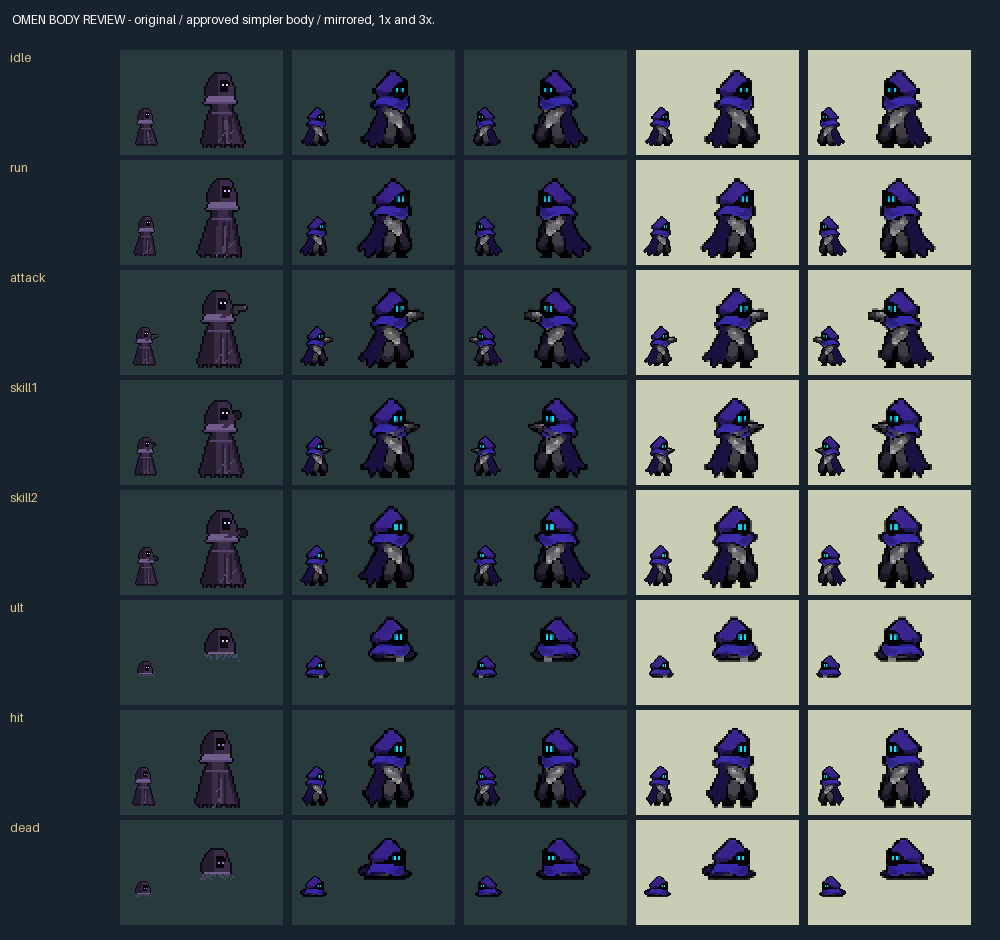
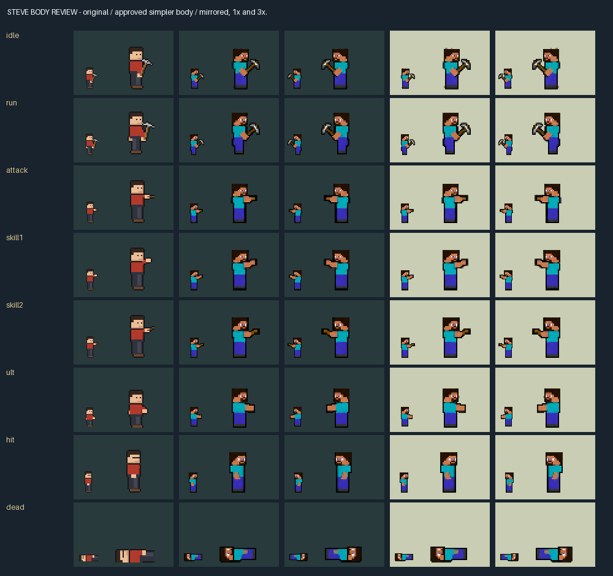

# Approved bodies, faster Gojo projectiles and athlete tactics

This extends PR #41's Steve/Herobrine rework. The release is native **0.10.62**, Blockcraft **0.1.21**, Custom **0.2.62**, JJK **0.1.32**, JoJo **0.1.18** and Valorant **0.1.13**. Publication does not install the mods or migrate a career.

## Artwork approval and reference basis

The user approved the simpler, flatter Omen and Steve bodies on 20 October 2026. Their frozen source images, approval hashes, all-pose contact sheets and animated comparisons are in [character-art-review](character-art-review/). The bodies retain the original 36×44 cells, foot registration, animation names, frame counts and timings. Herobrine shares Steve's body, with an explicitly registered white-eye layer for every frame and both facings. Body replacements introduce no combat commands or RNG calls.

- Omen follows the hood, three cyan face slits, segmented armour and scarf/cloak direction of [Riot's official character](https://playvalorant.com/en-us/agents/omen/).
- Steve follows the turquoise shirt, blue-purple trousers and square brown-haired face in the supplied [drawing reference at 9:16](https://www.youtube.com/watch?v=gSzDZZYG02A&t=556s).
- The supplied Reddit image was blocked by browser verification and remains visually unverified. No matching claim relies on it.

The approved Omen source omitted one terminal ultimate fade frame. Packing reuses the approved preceding hood at the original 14×8 fade bounds; the original frame duration and anchor remain intact. Both the original approval hash and repaired integration hash are recorded. This is a packing repair using approved pixels.





[Omen animation](character-art-review/omen-animation.gif) · [Steve animation](character-art-review/steve-animation.gif) · [All Herobrine frames](character-art-review/herobrine-all-frames.png)

Steve's original `blockcraft` atlas PNG bytes and animation metadata values remain unchanged. Canonical bindings in `rules/steve-presentation.json` reconnect the old TNT flight/ring/explosion, pearl/teleport, fishing line/hook, apple feedback, boat/splash and wall blocks. The existing ice path remains connected. Herobrine arranges those wall blocks on the committed curve. The existing stationary TNT carrier fallback remains: the original 10×12 TNT cannot cover its targetable 32×40 carrier. No new skill-effect artwork was drawn in this pass; the new eye layer is part of the approved body treatment.

Decoded runtime artwork is **2,792,448 bytes for Steve** and **2,681,472 for Omen**, below their 32 MiB limits; every atlas is within 2048×2048. Native animation phase alignment and crowded terrain readability still need live observation.

## Gameplay changes

| Gojo outgoing travel | Before | This release |
|---|---:|---:|
| Ordinary Blue | 12 flight ticks | 8 |
| Maximum Blue | 8,000 units/tick, minimum 12 ticks | 12,000, minimum 8 |
| Red / Maximum Red | 8,000 units/tick | 12,000 |
| Purple | 4,200 units/tick | 6,300 |

Rules generate native and editor constants. Curves, collision, warnings and artwork follow the same committed trajectory and travel clock. Returning Red still waits 48 ticks, keeps its damage split and delays knockback until the return blast. The orb lives 180 ticks after arrival. Costs, damage, preparation, ranges, Domain size and control duration remain unchanged. Signed curve offsets are rounded separately to preserve mirror symmetry at the shorter flight durations.

Dio, Gojo and Omen read a versioned nine-stat athlete profile through supported management APIs. Ego prices risk; Judgement influences deterministic evaluation error; Positioning affects entry/landing geometry; Control Speed affects reaction time; accuracy/dodge affect visible prediction/exposure; Aggressive, Order and Roaming affect suitable initiative and rotations. No action is rank-locked and these profiles grant no combat bonuses.

Profiles are pinned to career, match, set, seed, player and athlete, cached by the passive, and persisted both in the mod save and an append-and-sync journal. A replay without its original pin uses a logged neutral profile rather than today's athlete stats. The native management callback and real replay persistence still require live acceptance. See `athlete_ai.rs`; the supported stat keys correspond to the editor's existing athlete fields.

Dio and Gojo compare control coverage, one fixed allied guest, allied time lost, survival, teammate arrival and active Epic/Serpen objectives. Native objective identification uses entity kinds. A movement-only hook stages other allies outside a pending field, without replacing attacks, casts or urgent retreats. Dio has one native ultimate commitment path for migrated definitions; its legacy path remains for old saves. Gojo compares full and quick Void with actual resources, strain and post-Domain burnout, and can use a legal entry Step before re-evaluating.

Teammate arrival uses a conservative straight-route/blocked-route estimate, not an exposed host pathfinder. Pressure estimates use observed HP loss and nearby visible projectiles; the SDK does not expose exact projectile payload or future target HP. These estimates affect decisions only. The implementation never claims exact future damage or hidden-enemy knowledge.

Omen's Paranoia and Shadow Step each have a seven-second base cooldown. Native casts preserve the existing channels and ultimate's 80-second cooldown, fixed accepted destination and targetable shade counterplay. The policy considers recent shooting, confirmed blind, survival, useful firing access, remote fights, tower defence and active objectives without requiring a nearby foe to permit ultimate planning. Follow-up movement is invalidated when its target disappears. Failed shade creation grants neither an invisible teleport nor a spent ultimate cooldown. Legacy bindings remain compatible; migrated definitions do not also run the retired controller or synthetic enemy-bind trigger.

Aegis retains its original selected ally's data-route cast-time shield. At the first actual visible landing marker, one per-cast ledger snapshots living allied champions within **114,000 units inclusive**, granting **320 shield for 180 ticks** to unserved recipients. The selected ally is not refreshed. Marker movement, later entrants and repeat publication cannot rescan the pulse. Cancellation before the first marker grants no area shields. The existing native redirected-target fallback is also recorded in the same ledger.

## Automated verification

| Check | Result |
|---|---|
| Entire native release suite | **484 passed**, zero failed; four existing diagnostic tests ignored; no filters |
| Career migration | **8 passed**, including Dio/Omen/Aegis preservation and idempotence |
| Gojo native/WASM comparison | **51,840 complete-state/command frames**, 24 development + 12 holdout scenarios and independent sessions |
| Gojo browser suite | **13 checks passed**; ten technique demonstrations, curves/return, guest/allied stun, replay and frozen v1/v2/v3 readers |
| Steve recipes and browser replays | **15/15**; **12,960 complete-state/command parity frames**, 24 development + 12 holdout scenarios |
| Tactical lab | Nine fixtures, independent Omen cooldowns, fixed teleport, shade cancellation, boundary shield/late entrants and seven-frame native/WASM replay; no browser errors |
| Artwork | Reproducible generation, all 64 body frames and 31 eye frames, both facings, anchors/timing, legacy pixels and atlas limits |
| Independent release DLL builds | Identical source fingerprint and binary hash |

The release suite includes profile-dependent choices with identical manual mechanics, arriving/late/controlled allies, fog, ongoing objective loss, incoming danger, Omen failed shade and independent owners, and Aegis ledger duplication/cancellation boundaries. The tactical page shares the Rust policy, cooldown and recipient rules; its illustrative movement/channel simulation is not a complete native match adapter.

Steve's five-run, core-only median p95 at 128 units is **0.045 ms** (p99 **0.147 ms**). Magnus's unchanged 128-piece fixture reports **1.251 ms p95**, below 4 ms. Host simulation, first-use assets, crowded rendering, balance and win rate are not measured by these tests. Two existing test-only unused-method warnings remain in Coder/Magnus fixtures; production release builds completed successfully.

Detailed machine-readable evidence is in [character-tactics-results](character-tactics-results/), [Gojo v4 parity](gojo-results/v4-parity.json), [Gojo browser results](gojo-results/v4-browser.json) and [Steve results](steve-results/).

## Reproduction, packaging and migration

Run the existing generators, then:

```text
rtk proxy python -X utf8 tools/verify-character-art.py
rtk proxy python -X utf8 tools/verify-steve-art.py
rtk proxy python -X utf8 tools/test_rework_migration.py
rtk proxy rustup run stable-x86_64-pc-windows-gnu cargo test --release --lib --manifest-path native/tfm2_custom_ai/Cargo.toml
rtk proxy node tools/verify-gojo-parity.cjs
rtk proxy rustup run stable-x86_64-pc-windows-gnu cargo build --release --lib --target wasm32-unknown-unknown --manifest-path native/steve_lab/Cargo.toml
rtk proxy rustup run stable-x86_64-pc-windows-gnu cargo build --release --bin steve-vectors --manifest-path native/steve_lab/Cargo.toml
```

Copy Steve's WASM output to `editor/steve.wasm`. Start `editor/server.js --port 7283 --no-open`, then run `test-steve-lab.cjs`, `test-gojo-v4.cjs` and `test-tactics-lab.cjs` through `rtk proxy node`. `verify-gojo-magnus-regression.py` checks the unchanged Magnus target. `package-steve.py` pins `SOURCE_DATE_EPOCH`, compiles in two target directories, checks the source fingerprint and packages only identical DLLs. `check-steve-package-manager.py` verifies a complete isolated game fixture without installing into the real game.

Packaged native DLL SHA-256:

```text
81ee4320dc36711362f13e4ce6f0cd86aa23cc16b6761868b53b4cfbe4866e6d
```

The [package record](character-tactics-results/package.json) also contains both WASM hashes and synchronized versions. Mod Manager evidence is recorded separately in [its report](steve-results/mod-manager.json).

For existing careers, `rtk proxy python -X utf8 tools/migrate-champion-reworks.py <career-file>` only inspects. `--output <new-file>` creates a separate copy; `--in-place` verifies a complete backup before atomic replacement. Unknown bindings abort the entire migration. Only supported champion ability/passive/view definitions change; base stats, growth, items and career history are preserved. Repeating migration is a no-op. Keep the verified backup and do not overwrite later career progress during restoration. No real career was migrated in this task.

**Live acceptance remains pending:** carrier appearance/targeting, animation phase alignment, real athlete-profile/replay persistence, objective rotations and allied staging, Omen shade/interruption and follow-up plays, Aegis data/native timing, Gojo projectile counterplay, item/attribution interactions and crowded host performance. Installation remains separate and must happen only after closing the game.
