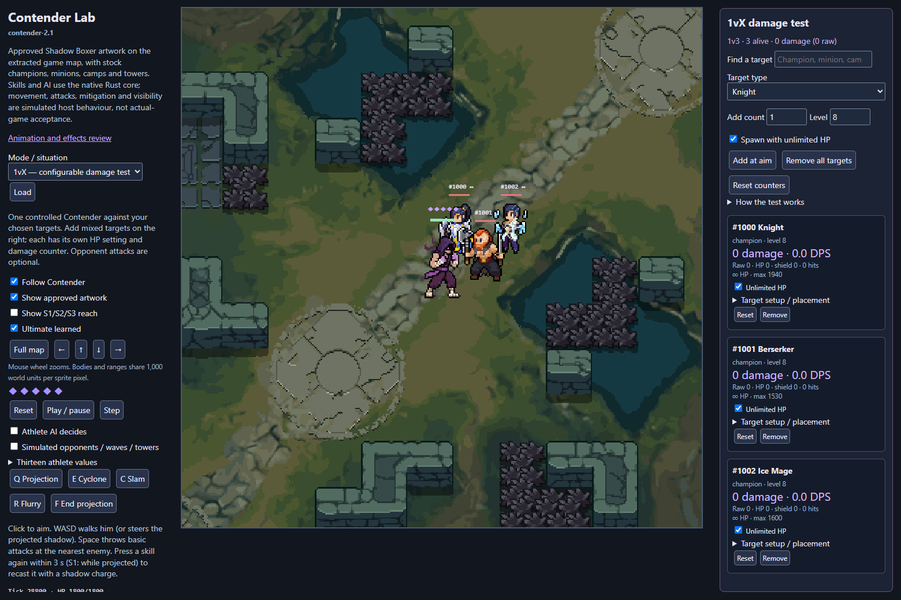

# Contender 2.1: configurable 1vX Lab

18 November 2026. Based on PR #91 head `4c111ab18e7d04053da91e06ee512d36d586d726`.

Reihan requested implementing the shared 1vX Lab requirement after updating PR #91. The current **contender-2.1** mechanic is preserved: casting Flurry from Projection makes its punches echo; Cyclone no longer primes it.

This is an editor/Lab change. Native gameplay, rules, the packaged DLL/WASM and approved game artwork are byte-identical to the incoming PR head. Versions remain native **0.10.113** and champion pack **0.2.116**. No installation, career migration or DLL packaging occurred.

## Using the Lab

Run `rtk proxy node tools/serve-contender-shadow-review.cjs`, then open:

<http://localhost:7309/editor/contender.html?build=contender-2.1-1vx>

The extracted installed-game reference must be present; otherwise run `rtk proxy node editor/extract-game-world.js`. The real map, registered walls and unit scale are retained. Both `/editor/contender.html` and `/contender.html` work through the review server.

- The default setup is **1v3**, with three stock champions using unlimited HP. Opponent attacks start disabled for damage inspection; the existing toggle can enable the basic-combat host model.
- On the **right**, search/select a target type, choose add count and level, click the map to aim, then use **Add at aim**. Add mixed types or remove individual targets to choose X.
- Each stable target ID has its own **damage, DPS, requested raw damage, HP damage, shield damage and hit count**. IDs also appear above units. Total damage means HP plus shield damage; DPS uses simulation time since that counter's first damaging packet, with a one-second minimum denominator.
- Each target has an independent **Unlimited HP** toggle. Expand **Target setup / placement** to set finite maximum HP, armour or starting shield, focus the camera, move it to the current aim, or refill HP.
- **Reset** in a target row clears only that counter. **Reset counters** clears all damage counters and aggregate host metrics. These do not reset cooldowns or cancel committed skills; delayed hits can begin a fresh counter window.
- The left **Reset** restarts the kit/test and clears counters, retaining the chosen 1vX targets, stable IDs, starting positions, levels, max HP, armour, shield settings and unlimited-HP choices.
- Existing laning, gank/countergank, camp, tower and objective situations remain under **Mode / situation**. Their enemies also receive right-side counters and can be configured for unlimited HP. New test targets can be added alongside them.
- Capacity is **64 configured targets / 128 total units**, within the existing WASM transport bound. Invalid counts, excess spawns and stale asynchronous loads are rejected.



## Target catalogue and simulation scope

There are **101 templates**: **60 stock champions, 28 custom champions, two minion types, four camp types, Morgard/Serpen, a tower, a nexus, a dummy, and two summon templates**.

Stock sprites/settings come from the extracted installed-game reference. Custom targets use shipped base-body atlases and generated champion definitions; Mod Power is resolved once from native/canonical rules, including attack-speed modifiers. Regenerate the custom catalogue after relevant champion changes:

```powershell
rtk proxy python tools/generate-lab-targets.py
rtk proxy python tools/generate-lab-targets.py --check
```

Wright fighter and Reflection are explicitly **configured summon templates**, using approved existing pixels with editable prototype test stats. They do not instantiate their full native controllers. Opponent abilities, mastery, item passives, special defences and engine AI are not simulated. This is stated in the Lab's expandable help. Tower selection does not make Contender's skills legal against towers.

The reusable pieces are `editor/lab-targets.js` (catalogue/art loader), `editor/lab-target-panel.js` (stable right-side controls), and `editor/lab-damage.js` (damage ledger and unlimited-HP host adapter). This delivery integrates them into Contender's Lab; it does not claim to have updated every other champion Lab.

## Unlimited HP measurement

Unlimited HP is **not invulnerability**. The host model applies ordinary physical mitigation and consumes real shield amounts, then records the resulting packet in a virtual unbounded HP sink. The actual target retains its finite configured max HP and is restored to that pool without a death, kill reward, healing event or additional damage packet. Thus a 5,000-damage packet can be measured on a configured 500-max-HP training target; percent/max-HP formulas still see 500, and the shared core never receives infinity or an inflated health pool.

Finite targets keep ordinary lethal/overkill behaviour. Other actors' damage does not count as Contender damage. The ledger records modeled host delivery, not verified native-game receipts. Resetting one row leaves the left inspector's whole-scenario aggregate totals intact; resetting all counters clears those aggregates too.

## Verification

- **12 new browser checks**: all templates load/draw, mixed setup controls, independent AoE counters, finite/unlimited HP, shields/configuration persistence, real UI custom-target spawn, target caps, tower restrictions, projected Flurry echoes, tactical scenarios and responsive layout.
- **8 existing browser checks** pass, including actual keyboard input/focus loss, 30–240 Hz fixed-clock playback, artwork on/off trace equivalence and manual athlete-profile independence.
- Damage-ledger checks cover mitigation, shield absorption, unlimited overkill, finite deaths, dead-target rejection, attribution and per-target/global resets.
- **24 development + 12 holdout scenarios / 5,400 frames**: complete native/WASM state and effects agree under **contender-2.1**. The parity runner now reads the canonical revision instead of hard-coding 2.0.
- **1,394 native tests passed, 18 ignored**; **84 targeted Contender tests** passed. Four inherited unused-code warnings remain in native bridge test helpers. These are the observed Windows GNU-toolchain counts, separate from earlier upstream reports.
- **2 Lab transport tests**, **15 Mod Manager tests**, canonical generation and catalogue checks pass.
- `git diff --exit-code` confirms no native core/bridge, gameplay rules, mod files or packaged WASM changes from the incoming PR head. Current hashes are in [regressions.json](regressions.json); they are not a new DLL reproduction claim.

Current evidence is stored here, separately from the original 2.0 artwork results in `docs/contender-shadow-review/`.

Reproduce with the local server running:

```powershell
rtk proxy node tools/test-lab-damage.cjs
rtk proxy node tools/test-contender-1vx.cjs
rtk proxy node tools/test-contender-shadow-art.cjs
rtk proxy cargo +stable-x86_64-pc-windows-gnu build --release --bin trace --manifest-path native/contender_shadow_lab/Cargo.toml
rtk proxy node tools/test-contender-shadow-parity.cjs
rtk proxy python tools/check-contender-1vx.py
```

The deterministic shared core is tested. Host movement, enemy combat, visibility, mitigation and unlimited HP are Lab simulations. Actual-game visual/combat acceptance remains separate and pending.
