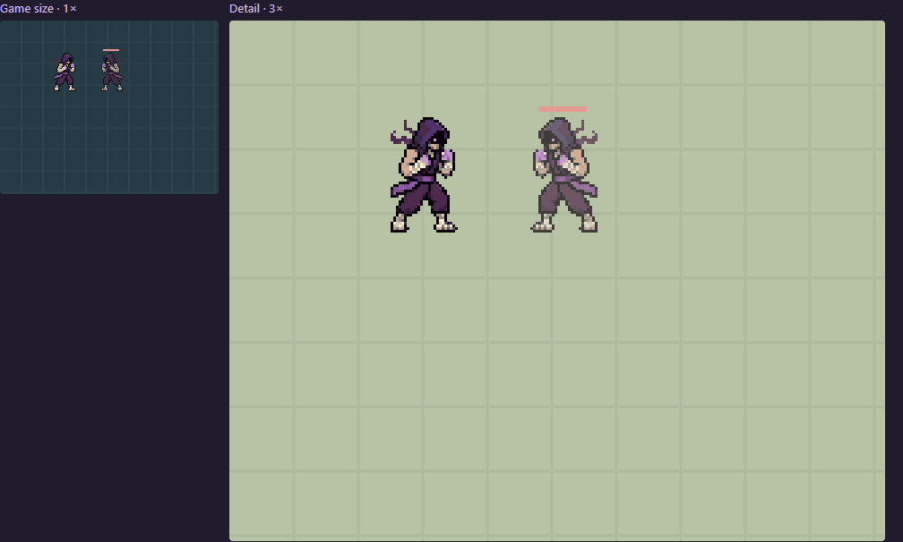

# Contender 4.0 art preview

Smother spreads as a violet dusk trail with a lavender front and one compact contact flash. Clone Army uses translucent versions of the approved boxer silhouette. The anchor keeps its darker standing figure and violet ground mark.

The [animated review](../../editor/contender-40-review.html) runs the 4.0 Lab WASM from [PR #112](https://github.com/PowerViber/tfm2_mods/pull/112). It draws the candidate artwork at 1× and 3× in both facings. Use the timeline to inspect Smother hits and misses, the three-clone formation, and the six clones plus anchor casting with Contender.

- [Smother contact comparison](smother-preview.png)
- [Clone Army with the anchor comparison](clone-army-preview.png)
- [Transparent Smother source](smother-source.png)
- [Transparent Clone Army source](clone-source.png)
- [Source crop and sizing data](sources.json)

Run `node tools/serve-contender-shadow-review.cjs 7320` from the repository root and open [the local review](http://localhost:7320/editor/contender-40-review.html).

The browser passed 16 combinations of scene, facing and angle. The largest cast showed eight simultaneous Smother lanes. The miss had zero contacts, and both army scenes returned to zero clones after expiry. Game-pack integration is pending visual approval.

## In the game (Claude)
`tools/build-contender-40-art.py` packs this art into `mods/tfm2_custom/vfx/contender_40#sheet.png`; see `docs/main-review-round-192.md`. [Packed in-game check](packed-in-game-check.png).
