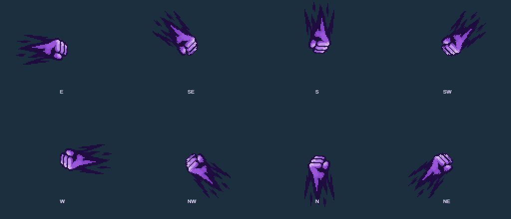

# Contender 2.2: Flurry switching and eight incoming directions

18 November 2026. Baseline: PR #91 commit `e8e99baef3d753dec9012d80fbd94be9793db5ea`.

Reihan observed Flurry sticking to one Lab target. The old search included its last victim, normally first at distance zero. It now **prefers a different eligible enemy within the existing 30,000-unit chain reach**, including target radius. It repeats the last victim only when no alternative qualifies. Creeps and summons count; existing visibility, targetability, team, tower and realm rules remain.

Alternatives retain champion/distance/entity-ID ordering. This prevents consecutive repeats; it does not promise a round-robin visit to every unit. Solo fights still receive all 36 punches, and no eligible target in reach still ends the Flurry early. Base damage, cadence, knock-up timings, projected echoes, reappearance, haymaker and cooldowns are unchanged. Distributing hits naturally changes each victim's Rhythm stacks.

## Directional punches

An optional eight-way heading is shared between native and WASM. Its deterministic owner/punch sequence consumes no combat RNG. The approved fist pixels approach from E, SE, S, SW, W, NW, N and NE, with the contact point anchored on the victim. The upright character body is not rotated.

Each cue still lasts **eight ticks** (four drawings), with **one gameplay damage packet per punch** and no additional CC or movement. Fresh definitions use numeric `shadow_directions_v1: 1`; older embedded definitions retain the existing horizontal fallback until separately migrated.

Legacy effect pixels/frames and the base body are unchanged. New tags are appended. Effects atlas: **1024×1086**; body: **960×256**; total decoded artwork: **5,431,296 bytes / 5.18 MiB**, within the existing limits.

Refresh <http://localhost:7309/editor/contender.html?build=contender-2.2-flurry>. The 1vX controls and counters remain. Rules are now **contender-2.2**; transport remains v1. Older recordings remain inspectable and require their original rules for replay.

PR #91 remains open, so its reserved versions stay **native 0.10.113 / champion pack 0.2.116**. DLL, WASM, bindings and generated tooltips/roster outputs are synchronized. Installation and career migration were not performed.

## Evidence

- **1,400 native tests passed; 18 ignored**, including **90 targeted Contender tests**. Four inherited unused-code warnings remain in native bridge test helpers.
- Native cases cover champion/creep/summon alternation, solo fallback, invalid/out-of-range alternatives, deterministic ties, eight headings, unchanged cadence and one packet per punch.
- Mock-host cases verify eight bound directional names, exact lifetimes, legacy fallback and no added damage/control/movement. Presentation enabled/disabled preserves the nonvisual trace.
- Shared-core Lab tests confirm 36 alternating punches, switching to a minion, 36 solo punches and all eight visible directions: [flurry-browser.json](flurry-browser.json).
- **12 1vX + 8 existing browser checks**, **2 transport tests** and **15 Mod Manager tests** pass.
- **24 development + 12 holdout scenarios / 5,400 frames:** complete native/WASM state and effects match.
- Reproducible packing, distinct/unclipped directional frames, legacy pixel identity, bindings and budgets pass: [directional-art.json](directional-art.json), [art-verification.json](art-verification.json).
- Two independent Windows builds and the packaged DLL match SHA-256 **`3fd1a216837c2414cd584eec9d7bde6d9c62eacfe719c1a184fee2245259f80f`**: [package.json](package.json).
- Isolated Mod Manager comparison passes for **902 files** without changing the real game/configuration: [mod-manager.json](mod-manager.json).

Earlier 2.0/2.1 evidence is preserved separately. Existing verification/packaging scripts accept `CONTENDER_RESULTS=docs/contender-flurry-review` and `CONTENDER_BASE=e8e99baef3d753dec9012d80fbd94be9793db5ea`. Additional checks: `tools/test-contender-flurry.cjs` and `tools/test-contender-flurry-assets.py`.

Automated and simulated Lab results passed. Actual-game targeting/visual acceptance, installation and backed-up career migration remain separate and pending.
