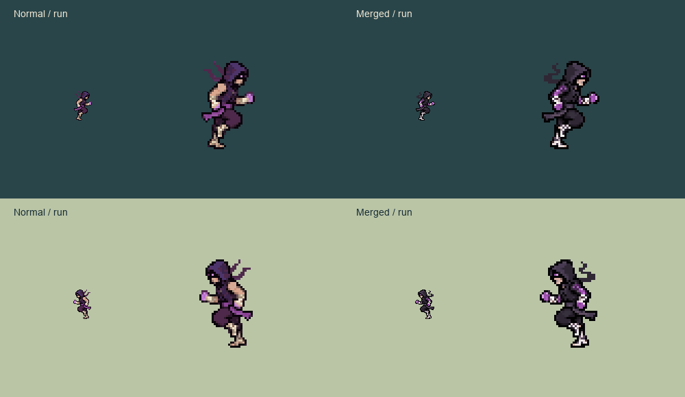

# Approved Shadow Merge: animation and native integration

Contender now has a fused charcoal/violet body during Shadow Merge. The approved hood, face, wraps and proportions remain recognisable. This completes the appearance approved by Reihan on 18 November 2026; no repeated appearance approval is needed. [Approval and source/prompt records](../contender-merge-review/animation-generation.json) retain the built-in imagegen provenance.

## What changed

- Completed **24 whole-body source drawings**, mirrored into **48 tiles**, covering all **20 existing animation names/aliases** with their original frame counts and durations. The new atlas is **960×256**; feet retain the **(40,52)** anchor on an **80×64** canvas.
- Native gameplay selects **one opaque following artwork-buff slot** by pose, frame and facing. Slot replacement clears the prior slot; expiry, step-out, death, respawn and Flurry concealment clear it. Static frames cover the full six-second Merge lifetime without effect-renewal gaps. No Animation CC, input injection, body hiding, stat change or runtime image composition was introduced.
- The visible normal sprite remains the fallback. New definitions opt into `shadow_merge_art_v1: 1`; older embedded definitions keep the legacy look until separately migrated. Native alignment of the layer over the engine's base body remains an actual-game acceptance item.
- The Lab uses the actual packaged atlas and draws one fused body during Merge. The [animation inspector](http://localhost:7309/editor/contender-merge-review.html) covers every frame, pose and facing at 1×/3× on light/dark terrain. Press **Q** in the [playable Lab](http://localhost:7309/editor/contender.html?build=contender-merge-2).
- Rules stay **contender-2.3**, transport **v1**, native **0.10.113**, champion pack **0.2.116**. Core rules, WASM and existing normal/effect pixels are unchanged. Test fixtures now fund the 2.3 ultimate through real skill hits and distinguish its 36 primary punches from additional Shadow Break packets.

Other packaged previews: [idle](merge-idle.gif), [attack](merge-attack.gif), [Merge cast](merge-projection.gif). GIF timings are rounded to 10 ms; the Lab and native pose tables retain exact original timings.

## Verification

- **1,403 native tests passed, 18 ignored**; four inherited unused-code warnings remain in bridge test helpers. New tests cover animation clocks, immediate slot replacement, independent owners, death/expiry cleanup and identical native combat commands/core state with presentation enabled/disabled.
- **2 Lab transport tests** and **15 Mod Manager tests** passed.
- **12 1vX + 8 existing browser checks**, dedicated Flurry checks and **7 Merge checks** passed. Every animation/frame/facing loads; the Lab clears the form on expiry/recast/death and does not reveal it during Flurry. Complete 420-tick presentation-on/off traces match; existing manual-profile 20/80 checks match.
- **24 development + 12 holdout scenarios / 5,400 frames:** complete native/WASM state and effects match under current 2.3 rules.
- Deterministic repacking, atlas bounds, mirrors, approval/source hashes and exact original animation timing validate. Legacy normal-body and effect files match the pre-Merge baseline byte-for-byte. Total decoded presentation is **6,414,336 bytes (6.12 MiB)**.
- Two independent Windows builds and the packaged DLL match SHA-256 **a8c69bba1b4c04738feeb8059d83491e00560f4db65ce1724c812345276fd2aa**. Source and WASM hashes are recorded in [package.json](package.json).
- Isolated Mod Manager comparison passed for **904 files**. No real game, configuration or career was changed.
- Five local browser contexts finished loading four actors in **309–463 ms**; warm draw-submission measurements are recorded in [performance.json](performance.json). They measure CPU submission in this Lab, not actual-game GPU performance or Proceed/day advancement.

Evidence: [automated.json](automated.json), [browser-suites.json](browser-suites.json), [merge-browser.json](merge-browser.json), [parity.json](parity.json), [art-verification.json](art-verification.json), [mod-manager.json](mod-manager.json). The earlier concept-stage evidence remains in `docs/contender-merge-review/`; 2.0/2.1/2.2 results remain in their original folders.

## Reproduction and remaining acceptance

Run `tools/build-contender-shadow-art.py`, `tools/generate-contender.py` and `tools/verify-contender-shadow-art.py`; use `CONTENDER_RESULTS=docs/contender-merge-integration-review` to preserve earlier results. Run the existing browser suites plus `tools/test-contender-merge.cjs`. `tools/package-contender-shadow-art.py` reproduces the reserved DLL; `tools/check-contender-shadow-manager.py` uses a disposable fixture. Match `CONTENDER_BASE` to `6626c55d272966ea5bcf969e748beb74bbfab60e` for this comparison.

Actual-game base/layer alignment, facing during engine attacks, buff-renderer cleanup and crowded-fight readability remain **pending**. Appearance approval, automated checks and the Lab are separate from native visual acceptance. Installation and backed-up career migration were not performed.
