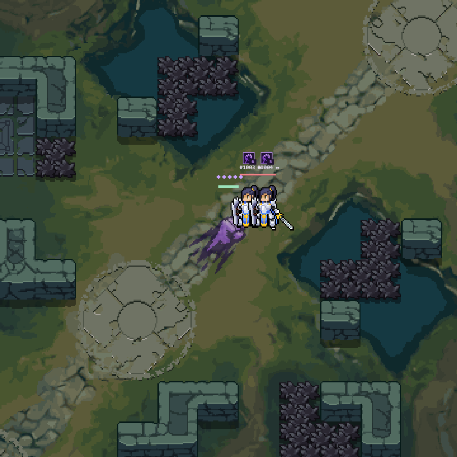

# Contender Lab: enemy Shadow Rhythm stacks

The playable Lab now shows a small violet fist logo with a tiny numeric count above each living, visible enemy with active Shadow Rhythm stacks. Reihan's correction replaces the text badge: there is no passive name or `count/maximum` label overhead. The icon reuses the approved uppercut fist pixels, cropping out the travel trail without changing packaged artwork. Counts come directly from the shared core's per-target `state.stacks` entries, using the canonical `tick < until` expiry. Gold indicates ten stacks. The icon follows the target and remains readable above map foreground artwork. Allies, hidden/dead enemies, expired entries and the owner's lingering buff do not produce enemy icons.

This was implemented as a Lab HUD change under `contender-2.2`, transport v1. It changed no rules, native/WASM binaries, gameplay, packaged artwork or release versions. Nothing was installed or career-migrated. Native-game stack presentation is outside this change.

## Verification

- `browser-observations.json`: actual shared-core Flurry produced separate **6** and **5** counts; both reached the maximum **10**. Drawing preserved core state. Checks covered movement tracking, hidden/dead/allied exclusions, exact expiry, reset cleanup and no browser errors.
- `browser-results.json`: all **eight existing artwork/Lab checks** passed, including equal complete combat traces with artwork on/off and manual profiles 20/80; exact 60 Hz simulation at 30/60/120/144/240 Hz; focused keyboard input and focus-loss cleanup.
- `1vx-browser.json`: all **twelve existing 1vX checks** passed, covering actual target assets, independent damage counters, finite/unlimited HP, setup preservation, mixed targets and layout.
- Native suites were not rerun for this UI-only change. Their earlier evidence remains in `docs/contender-flurry-review/`; these browser observations do not establish actual-game acceptance.

Re-run the existing checks without overwriting prior evidence by setting `CONTENDER_RESULTS=docs/contender-rhythm-hud-review` and running `node tools/test-contender-1vx.cjs` and `node tools/test-contender-shadow-art.cjs`. Start the local server with `node tools/serve-contender-shadow-review.cjs`; use `/editor/contender.html?build=contender-2.2-rhythm`.

## Compatibility with the subsequent 2.3 update

The PR advanced to `contender-2.3` in commit `0436ae1` after the icon was published. That update retains the icon. `2.3-smoke.json` records a fresh actual-WASM Cyclone check: the icon showed the target's authoritative count **3**, drawing preserved core state, and both icon/count cleared at the exact expiry tick. No browser errors occurred. The twenty browser checks above remain **2.2 evidence**; this small follow-up is not a claim that the complete 2.3 kit/parity suite was rerun. Current preview: `/editor/contender.html?build=contender-2.3-icons`.
