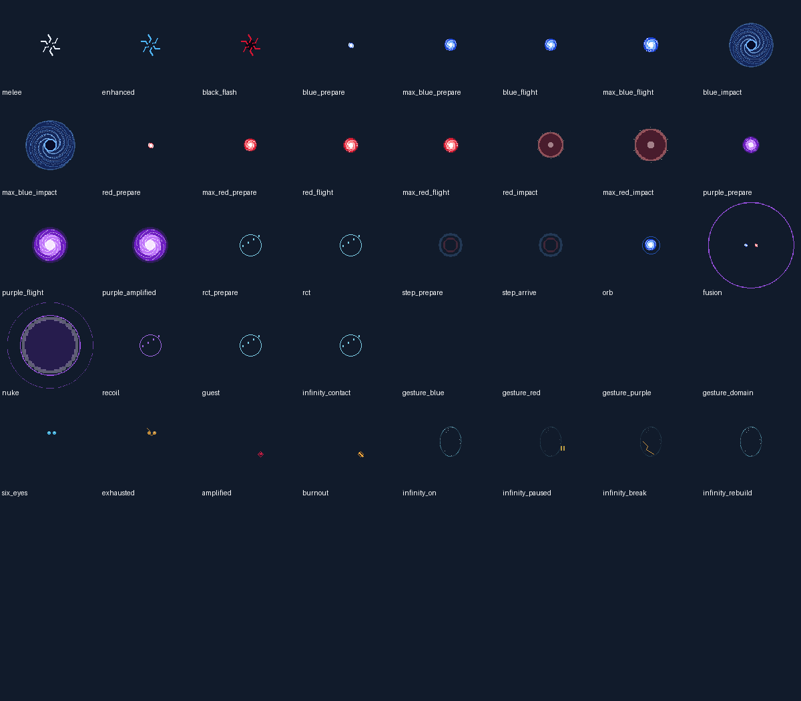
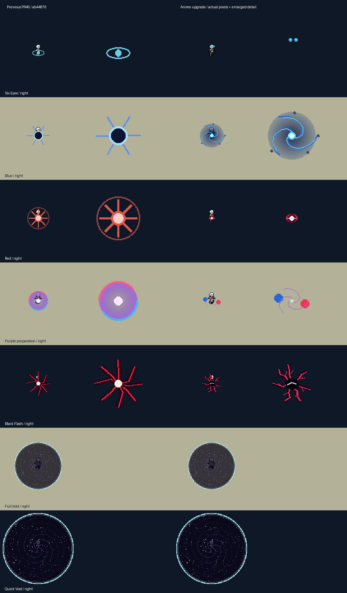
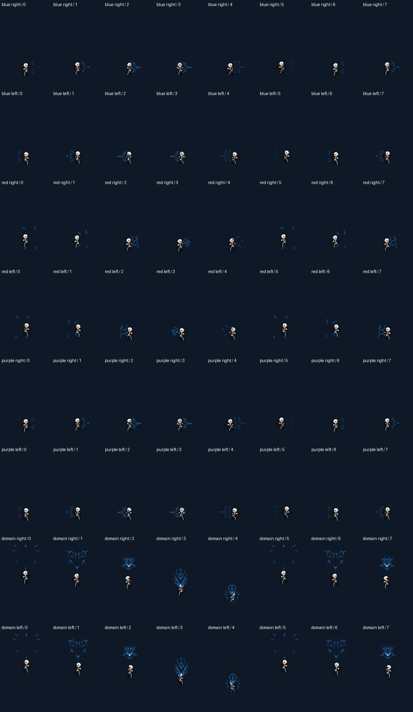

# Gojo: anime-inspired skill presentation

**Historical presentation revision.** The user subsequently chose the original pre-PR40 style. See [Gojo v3](gojo-v3.md) for the current kit and artwork. The immutable version of this anime report and its images is [pinned to d0b0866](https://github.com/PowerViber/tfm2_mods/blob/d0b08660813e5bc8178c8a7cb88f0f9528eb51b2/docs/gojo-anime-skills.md); current generated review images reflect the restored style.

This visual revision continues PR #40 on `codex/gojo-six-eyes-black-flash`. It keeps native 0.10.59 / JJK 0.1.30 / custom 0.2.60 for the same draft release. Main remains at a4098f1; the separate objective/Stark PR is excluded. No installation or career migration was performed.

The combat core, fields, numerical rules, AI and random state are unchanged from ab44870. Across 51,840 identical manual/automatic frames, every original output field and numeric command array matches the preceding build. The only additional protocol field is optional `presentation`. See [combat equivalence](gojo-results/anime-combat-equivalence.json).

## Reference evidence

The reference is the verified **Prime Video AU & NZ** clip [Gojo’s Hollow Purple](https://www.youtube.com/watch?v=7LzDcr20SHc), reviewed in the browser through sampled keyframes. This was not a viewing of the complete anime series.

| Clip time | Directly observed detail | Use in this revision |
|---|---|---|
| 00:23 and 00:38 | Cyan iris lighting and fine radial detail | Small eye highlights and restrained precision shimmer |
| 01:32 | Separate coloured energy components | Blue/red separation before Purple converges |
| 01:49 | Extended fingers, brilliant white central glint, violet lighting and thin crimson rays | Purple gesture, white-violet core and coloured ribbons |

The clip does not verify every technique. Blue debris/whirlpool graphics, maximum-output silhouettes, Black Flash branching, RCT threads, afterimages, Nuke warning stages, HUD symbols and cosmic polish are authored mod adaptations. All current combat adaptations and manga-access limitations remain documented in [Gojo v2](gojo-v2.md).

## Complete visual kit

| Technique | Result |
|---|---|
| Six Eyes / exhausted eyes | Compact cyan iris detail; dimmed eyes with a cracked amber indicator |
| Infinity | Spatial arcs, a localized contact crescent, and separate active, paused, broken and rebuilding layers |
| Melee / enhanced punches | Directional impacts; blue knuckle attraction trails without additional damage events |
| Black Flash | Irregular dark core, branching crimson lightning and a brief local white glint; small amplification marker |
| Blue / Maximum Blue | Inward cyan/navy spirals and baked debris; denser maximum geometry; visual spin follows actual spiral state |
| Red / Maximum Red | White-hot fingertip point, crimson contours and outward pressure rings; maximum charge remains distinct |
| Purple | Separated red/blue preparation, white-violet convergence, dense travelling body and a directional wake; amplified variant |
| Hollow Nuke | Red converges into the owned orb, three-stage warning, local branching detonation and pressure shell; owner recoil accent |
| RCT | White-cyan restoration threads and rising fragments; medical crosses removed |
| Spatial Step | Compressed silhouettes and stretched linear afterimages; paired portal rings removed |
| Full / quick Void | Original spiral, stars and border retained, with baked interior star motion; existing 64,000 / 96,000 radius sizing fix preserved |
| Guest / resources | Cyan shelter marker and CE; amber strain and burnout; amplification stays compact |

Blue attraction, Red fingertip, Purple convergence and Domain crossed-finger overlays have mirrored artwork. Per-pose hand anchors follow the original body frame timings, including tall Red/Domain frames. Existing body pixels, frame dimensions, animation order, durations and statistics remain intact. Actual engine hand alignment remains a live acceptance item.







## Presentation and compatibility

`rules/gojo-visuals.json` owns palettes, frame phases, anchors, variants and visual limits. Original body metadata supplies pose durations. Generation produces the atlas, native timing/anchor data and `editor/gojo-visuals.json`. The native and WASM adapters share the read-only presentation projection; it never mutates combat state, allocates combat event IDs or consumes gameplay randomness.

Transport **v2** keeps its input layout and original numeric command arrays, including `[6,kind,x,y,ticks]`. Optional `presentation.version = 1` supplies semantic tags, preparation/flight/impact phases, start/end clocks, facing, selected frame and pixel hand offsets. Older v2 recordings without this field still compare their full original output and use their existing fallback effects. The frozen v1 reader, WASM, core and controller remain unchanged.

Native continuous effects renew from an eight-tick animation window at their real elapsed phase. They do not restart from frame zero. Hand overlays use the body’s current frame and one-tick lifetime. Orb clocks continue across renewals and carry a lifetime digit. Preparation, fusion and whirlpool tails are bounded by eight ticks; already released impacts may finish visually. Native visual requests are bounded to 48 per owner per update, and the lab retains its 48-effect bound. Debris, lightning and star detail are baked rather than emitted as separate effects.

The original body, original effects and frozen v1 rework frames were losslessly repacked. Their decoded pixels and metadata are verified against pinned Git baselines. Total decoded Gojo artwork, including compatibility, is **32,683,008 bytes (31.17 MiB)**; all atlases are at most **2048×2048**. New and legacy effect names resolve, including the missing 64,000/96,000 warning bindings. The existing backed-up migration refreshes these visual bindings while retaining career fields; publication does not apply it.

## Verification

- [Native/shared suites and migrations](gojo-results/verification.json), [native log](gojo-results/native-tests.txt), [shared log](gojo-results/shared-tests.txt).
- [51,840 native/WASM parity frames](gojo-results/parity.json), including matching optional presentation; [identical combat against ab44870](gojo-results/anime-combat-equivalence.json).
- [Presentation windows, anchors and bindings](gojo-results/anime-presentation-verification.json), [reproducible art and legacy frames](gojo-results/art-verification.json), [art budget](gojo-results/v2-art.json).
- [Browser checks](gojo-results/browser.json) and [presentation/old-recording checks](gojo-results/anime-browser.json): 40 variants across both facings and light/dark terrain, interruption, death, Purple phases, replay and a crowded lab fixture.
- [Domain size checks](gojo-results/domain-size.json), preserving alpha boundaries during star polish; [frozen v1 compatibility](gojo-results/v1-compatibility.json).
- [Five browser rendering runs](gojo-results/anime-render-performance.json): fresh-context load measured separately from sustained canvas submission. These are CPU submission measurements, excluding GPU completion and native host rendering.
- [Core timing](gojo-results/performance.json) and [Magnus 32/64/128 regression](gojo-results/magnus-stress.json). Magnus’s 128-piece p95 remains below 4 ms.
- [Independent DLL builds and package hashes](gojo-results/package.json), [isolated Mod Manager verification](gojo-results/mod-manager.json).

**Live game acceptance remains pending.** Host effect anchoring, crowded native rendering, item/attribution behavior and real-game cleanup have not been observed in this revision. No freeze-fix or live-performance claim is made. No camera shake, hit-stop, full-screen flashes or cut-ins were added.

## Reproduce

After the generation/build commands in [Gojo v2](gojo-v2.md):

```text
rtk proxy python tools/verify-gojo-presentation.py
rtk proxy python tools/preview-gojo-anime.py
rtk proxy node tools/test-gojo-presentation.cjs
```

The main Gojo Lab and Skill Test iframe use the complete upgraded kit. The appearance inspector exposes every variant, gesture, status and terrain/facing option.
