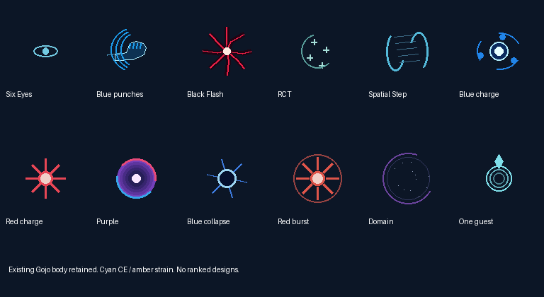
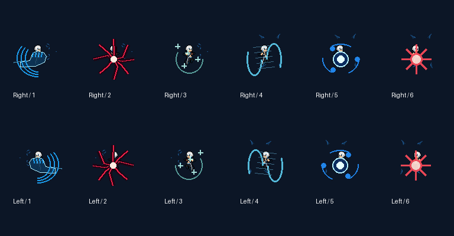

# Gojo: Six Eyes and Black Flash

Gojo retains his body, statistics, growth, melee rhythm, internal identity and existing native stat bonus. The new controller owns CE, strain, techniques, projectiles, Infinity and Unlimited Void. It does not introduce mastery variants. Blue/Red/Unlimited Void keep their slots; maximum-output casts, Purple, RCT and Spatial Step are contextual decisions with manual lab controls.

## Combat

- CE starts at 100, regenerates 3/s in champion combat and 6/s after four seconds without champion damage. Six Eyes efficiency is already included in costs.
- Strain recovers 4/s after 1.5 seconds without starting a technique. At 100 it causes four seconds of burnout and closes Domain. Domain closure causes three seconds of burnout. Cooldowns survive death; respawning restores CE and clears strain.
- Blue/Red impacts on the selected, visible champion bind a four-second combination. Two qualifying melee impacts earn Black Flash; projectile components cannot reset the unfinished sequence. Each qualifying punch spends one CE and adds one strain. Black Flash adds 30 + 35% AP, relieves ten strain, and has a six-second trigger cooldown.
- Black Flash grants 20% more kit damage for eight seconds, evaluated once at impact. Further flashes refresh the duration. The triggering hit only receives amplification that was already active. Healing, shields and control durations are unchanged.
- Blue gives two enhanced punches for four seconds: 15 + 20% AP each and a terrain-clamped pull. Ordinary displacement respects CC immunity; Domain retains overload sealing.
- One preparation runs at a time. Commitments spend resources and start cooldowns immediately; interruption cancels unreleased work without refunds. Preparations hold the casting position. Released spells continue physically through fog but cannot earn hidden combinations.
- The automatic policy reserves escape energy, prefers viable combinations, and rejects Domain when its current position would catch more than one teammate. Manual commands have the same legality and damage regardless of athlete.

| Technique | CE / strain | Cooldown | Preparation |
|---|---:|---:|---:|
| Blue / maximum | 6 / 5; 12 / 15 | 10s shared | 0.4s; 0.9s |
| Red / maximum | 10 / 7; 20 / 18 | 9s shared | 0.4s; 1s |
| Purple | 34 / 30 | 20s, also starts Blue/Red | 34 ticks |
| RCT | 20 / 8 | 14s | 0.6s |
| Spatial Step | 8 / 8 | 12s | 0.2s |
| Unlimited Void | 40 / 45 | 60s | Existing slow/fast expansion |

Purple requires the ultimate and both normal skills ready. Its original 200 + 160% AP, 400,000 travel, 26,000 radius, speed and recoil are retained. Maximum Blue/Red deal 135% normal damage. RCT heals 80 + 50% AP over one second. Spatial Step travels at most 32,000 along a clear, walkable route without crossing a hostile barrier.

## One Domain guest

The centre is fixed at commitment. Select the nearest living allied champion within 76,000 once, breaking ties by entity ID. Gojo and that guest remain protected; every other allied champion caught by expansion is stunned and sealed alongside enemies. The guest is never reassigned. Slow expansion/seal/self-lock remain 150/240/30 ticks; fast remains 45/120/15. Existing ten-second damage, speed and cooldown bonuses begin when expansion finishes. Death and overload close the owned Domain without clearing unrelated crowd control.

Warnings feed the shared movement-only hook. Purple publishes bounded firing-line geometry as well as travelling warnings. Domain warnings are owner-aware so its caster and guest are exempt. World warning/guest layers renew for eight ticks at six-tick intervals; cancellation leaves at most eight ticks of visual tail, without damage or control.

## Approved Infinity policy and SDK limits

Infinity retains its 200 + 50% AP shield, 75% skill / 30% basic reductions, one CE/s upkeep, 15-second break recovery and five-CE rebuild cost. During CE shortage or burnout, **the remaining shield may absorb damage while reductions and rebuilding pause**, as approved by the user. Resuming does not refill a partial shield.

The SDK exposes total shielding, adding a layer, and clearing all layers. It exposes neither a shield-layer handle nor removing one layer. This implementation never clears shields, so allied layers remain untouched. Aggregate shielding can obscure the precise moment Infinity's own layer breaks when allied shields overlap; live verification must include that case.

The SDK also lacks arbitrary-point visibility. Spatial Step conservatively accepts a short unobstructed ray from Gojo, rejecting terrain, active boat walls, smoke and hostile Domains. This is a visibility approximation, not a hidden-information query.

## Native boundary and compatibility

`rules/gojo.json` generates matching Rust/editor constants. The host-free Rust core is also compiled into `editor/gojo.wasm`. The thin native adapter uses the supported API and one native basic-impact inbox. It emits a single paired physical/magic `BaseAttack` damage request, rather than separate attacks for enhanced punches or Black Flash. The data's old basic damage and flag machinery are replaced by that effect; skill slots are inert shells. The retired Domain hook skips reworked owners and remains available for unmigrated definitions.

ABI mock tests prove the adapter emits one attributed damage request and does not clear allied shields. They **do not prove the installed engine's callback ordering, mitigation, item procs or credited damage**. Those require live acceptance. No executable patch or private engine write is used.

## Lab and artwork

Open **Gojo Lab** from the editor or Skill Test. All techniques, impact events, unlocks, interruption, fog, walls, moving enemies, two owners, death and replay are available. CE, strain, cooldowns, amplification, combination, burnout, guest and complete core state are inspectable. Stunned allies/enemies stop moving and attacking in the scene. Recorded inputs are replayed against fresh cores and checked against complete state and commands before restoring the scene.

The lab's health is a raw-damage fixture, not engine damage statistics. It does not claim engine armour, item or kill-credit parity.

Existing 73 body frames and 157 effect frames match the main baseline in decoded pixels, dimensions, anchors, ordering and duration. Blue, Red and Purple flight artwork retains its original size and frame cadence. New effects cover Six Eyes, resources, enhanced punches, Black Flash, RCT, Spatial Step, maximum output, Infinity states and the guest. No body redesign or rank outfits were added. Current decoded art and atlas dimensions are recorded in [art.json](gojo-results/art.json), with all atlases at most 2048 per side and total below 32 MiB.





## Reproduce and migrate

The branch starts at main `a4098f15be65edc683fd62f8037d71b1e79ae9bd`, with its 18-equation Unified kit. Releases are native **0.10.58**, JJK **0.1.29**, and custom pack **0.2.59** (dependency synchronization only). The separate objective/Stark PR is not included.

On the development Windows GNU toolchain:

```text
rtk proxy python tools/generate-gojo-rules.py
rtk proxy python tools/generate-gojo-art.py
rtk proxy python tools/generate-gojo-champion.py
rtk proxy node editor/server.js --port 7281 --no-open
rtk proxy node tools/verify-gojo-parity.cjs
rtk proxy python tools/verify-gojo-release.py
rtk proxy python tools/package-gojo.py
rtk proxy python tools/check-gojo-package-manager.py
```

The browser check uses Playwright and installed Microsoft Edge. Other checks do not need a game window. The package script builds to two independent target directories, compares DLL bytes, and copies only into this checkout's mod package. Mod Manager runs against a separate full-package installation fixture. Neither script installs into Steam or edits a career.

Existing careers can contain old champion definitions. With the game closed, first inspect an explicit file:

```text
rtk proxy python tools/migrate-champion-reworks.py "PATH_TO_CAREER"
rtk proxy python tools/migrate-champion-reworks.py "PATH_TO_CAREER" --output "NEW_CAREER_COPY"
```

`--in-place` is optional and first verifies a complete timestamped backup before atomic replacement. Unknown native controllers abort the complete update. Repeated application is idempotent. Statistics, growth, items and history stay intact. To restore, preserve the migrated file separately and restore the verified backup only if the current file still matches the migration's reported result hash; later edits require separate reconciliation. No user career was migrated for this delivery.

## Evidence and acceptance

- [Automated check report](gojo-results/verification.json), [native suite](gojo-results/native-tests.txt), [shared-core suite](gojo-results/shared-tests.txt), [migration tests](gojo-results/migration.txt).
- [Native/WASM parity](gojo-results/parity.json): 51,840 complete state-and-command frames, 24 development and 12 holdout scenarios, two independent sessions per scenario.
- [Browser checks](gojo-results/browser.json), [frame equivalence and reproducibility](gojo-results/art-verification.json), [animated preview](gojo-results/skills.gif).
- [Five release-core timing runs](gojo-results/performance.json), [Magnus 32/64/128-piece regression](gojo-results/magnus-stress.json). Timings exclude native host calls and rendering. The fixed input stress case is not a balance match.
- [Reproduced/package DLL hash](gojo-results/package.json), [isolated Mod Manager result](gojo-results/mod-manager.json).

**Live acceptance remains pending**, as requested when the game would not open: actual impact ordering and item procs, engine-attributed damage/credit, warnings and teleport boundaries, layered Infinity shields, guest protection/allied stun, death cleanup, crowded host performance, and matched baseline/candidate duels/team fights/farming. There is no claim yet that the whole rework is a measured overall buff or that a game freeze was fixed. Compare actual damage, survival, combinations, starvation, burnout, wasted preparation and allied time lost to Domain separately.
