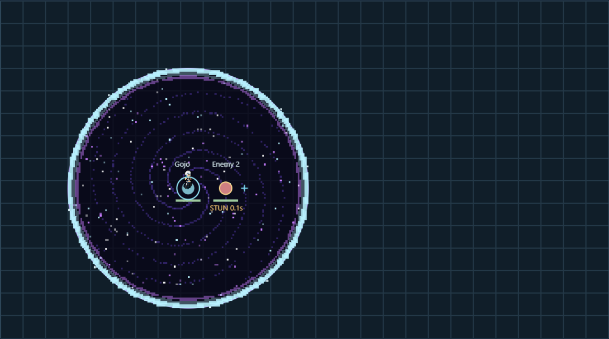
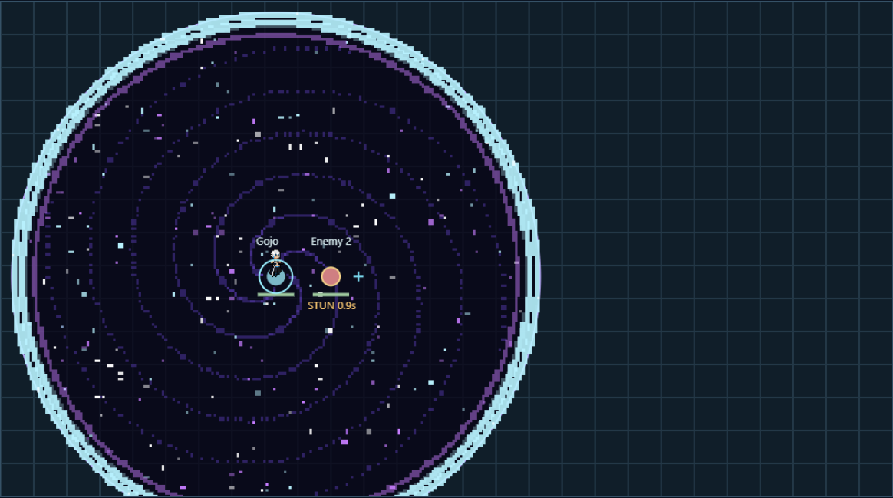
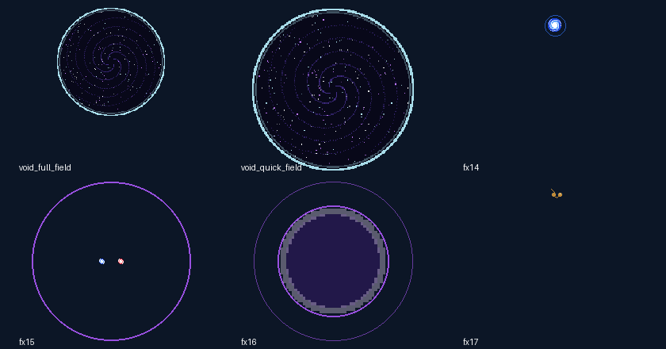
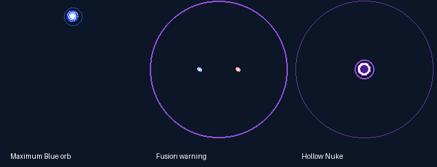

# Gojo v2: Six Eyes focus, two Domains and Hollow Nuke

This supersedes the first PR #40 rules. Gojo keeps his body, base statistics, growth, ordinary attack clock, saved identity and permanent native stat bonus. There is no mastery system. Releases: native **0.10.59**, JJK **0.1.30**, custom pack **0.2.60** (dependency synchronization). Objective/Stark PR #39 remains separate.

## Combat rules

Six Eyes starts active and restores automatically; there is no combat toggle. It discounts all CE consumption by 90%, doubles technique cooldown progress and multiplies kit damage by 80% at impact. Item cooldown modifiers still apply. Black Flash multiplies damage by 120% for eight seconds, refreshing without stacking; both together give 96% before other modifiers. The triggering strike resolves before its new amplification. Healing, shields and the nuke HP cost are unchanged by these multipliers.

| Technique | Active CE | Eye strain | Base cooldown / with active eyes |
|---|---:|---:|---:|
| Blue | 0.6 | 5 | 10s / 5s |
| Maximum Blue | 1.2 | 70 | shared Blue clock |
| Red | 1 | 7 | 9s / 4.5s |
| Maximum Red | 2 | 80 | shared Red clock |
| Ordinary Purple | 3.4 | 30 | 20s / 10s; also starts Blue/Red |
| RCT | 2 | 8 | 14s / 7s |
| Spatial Step | 0.8 | 8 | 12s / 6s |
| Quick / full Void | 4 | 50 / 80 | 60s / 30s shared |

CE starts at 100 and regenerates 3/s, or 6/s after four seconds without champion damage. Enhanced qualifying punches cost 0.1 CE with eyes, one CE without. Infinity upkeep is 0.1 CE/s and rebuilding costs 0.5 CE while eyes function. The ordinary attack clock, six-second Black Flash trigger cooldown and fifteen-second Infinity break recovery are never accelerated.

Eye strain caps at 250. Active recovery is 4/s after 1.5 seconds without strain-generating techniques. Exhaustion collapses Domain and pauses Infinity reductions/rebuilding; recovery becomes 20/s until focus restores at 50. Only melee, ordinary Blue/Red and Spatial Step remain available while exhausted, at full CE costs and normal cooldown recovery. These fallback casts do not delay eye recovery. Eye-required commitments need enough headroom to remain below 250. Normal fallback techniques may reach the cap and still release.

Domain closure separately causes three seconds of Limitless fatigue. It locks Blue/Red, maximums, Purple, Step, Domain and Infinity. RCT remains available if eyes function. Restrictions combine when exhaustion overlaps fatigue. The v1 ten-second Domain stat/cooldown bonus is removed. Released spell effects remain physical; death cancels owned pending work. Cooldowns survive death; respawn restores resources.

Infinity retains its 200 + 50% AP shield and 75% skill / 30% basic damage reductions. During pauses the remaining shield may absorb damage, as approved, without refilling. The SDK exposes aggregate shields, so allied layers can obscure the exact break of Infinity's own layer. The controller never clears allied shielding.

## Spiral, orb and fusion

Blue deals its existing impact damage once and moves eligible enemies along a terrain-checked inward spiral: 0.6s/about 270 degrees, or 0.9s/about 360 degrees for maximum Blue. It ends at a small inner orbit. Cleanses and CC immunity stop movement. Towers, nexuses, Morgard and Serpen never move. Motion and the lingering orb do not deliver periodic damage.

Maximum outputs require active eyes and an active Black Flash window at commitment. Maximum Blue leaves one stationary six-second orb per owner; another cast is rejected while it exists. New entrants get at most one brief spiral per orb. Orb, motion and fusion histories are owner-local.

A direct same-owner maximum Red/orb collision consumes both and warns for 0.8s at the fixed fusion point. An enemy body-block before the orb resolves normal maximum Red instead. Ordinary Red, another owner's spell and splash overlap cannot fuse. Hollow Nuke deals **400 + 240% AP magic damage once** to eligible enemies within 96,000, excluding structures and allies. It then subtracts **floor(current HP / 2)** from Gojo, even outside the blast, leaving at least one HP; this bypasses shields and damage/item attribution. It adds 75 strain after impact. Formed blasts survive eye exhaustion but not Gojo's death. Ordinary travelling Purple remains separate and needs eyes, ultimate unlock and both ordinary cooldowns ready; it needs no Black Flash.

The automatic policy prioritizes survival, viable combinations and valuable firing lines. It avoids long maximum preparations in close danger unless the target is already sealed. Automatic fusion requires at least half HP and two visible enemy champions within the predicted blast. Manual legal casts remain available. Farming uses ordinary Blue/Red and preserves major techniques.

## Unlimited Void

| Mode | Radius | Warning / casting lock | Control |
|---|---:|---:|---|
| Quick, “0.2 seconds” | 96,000 | 0.2s | 0.2s exposure; one 1s stun per caught champion |
| Full | 64,000 | 1s | 4s maintained seal after opening |

Both require Six Eyes. Centre and guest are fixed at commitment. The guest is the nearest living allied champion in that mode's radius, with entity ID as tie-breaker. Gojo and the guest are protected while open; every other caught allied champion is controlled like an enemy. Guest status never transfers. Quick stun can outlast field closure. Full seal uses short refreshes and ends on collapse without clearing unrelated crowd control. Only full Void has a maintained boundary.

The pre-PR40 cosmic interior, ring and cast frames are restored from retained artwork, scaled for the two radii. Animation frame selection follows their original duration metadata; rendering performs no search or gameplay RNG. Native warnings renew briefly through the shared danger mechanism. A cancelled renewed visual can linger at most eight ticks. Already released impact animations may finish visually without further gameplay effects.

The original design now fills each gameplay boundary in the lab, including the expanding ring. Native art sizes are derived from the canonical radii: full **140px** at 64,000 units, quick **210px** at 96,000 units. Open fields use the fully expanded interior frames; quick mode no longer disappears while still showing the old small opening sphere. The body and original frame pixels remain unchanged. [Rendered size checks](gojo-results/domain-size.json) compare both modes with the earlier preview and confirm identical combat state.





## Compatibility and lab

New definitions bind `tfm2_custom_ai:gojo_v2` and `gojo_basic_v2`. The old `gojo`, `gojo_basic`, v1 core/rules/protocol and legacy Domain hook remain for older embedded definitions and recordings. V1 combat semantics are unchanged; its Domain geometry helper is merely exposed to the v2 adapter. Each passive owns its own mutable state. The basic callback remains one inbox event followed by one paired physical/magic BaseAttack request, preserving a primary attack identity.

The main lab uses transport **v2** and refuses v1 frames. Explicit quick/full Domain and orb-targeted maximum Red controls, eye state, 250 strain, fatigue, orb/fusion times, cooldowns, rejection reasons and complete state are exposed. Replay checks full core state and commands. Stunned units stop moving and attacking. The [frozen v1 lab](../editor/gojo-v1.html) retains its original WASM and reader. Scene HP is a raw fixture, not engine damage statistics.

Champion migration remains explicit, inspected by default and backed up before atomic in-place replacement. It accepts known legacy/v1/v2 Gojo bindings, preserves stats, growth, items and history, and is idempotent. Unknown controllers abort the update. Run only against the intended career/database, never replay archives or already created match snapshots. No user career was migrated and nothing was installed into Steam.

```text
rtk proxy python tools/migrate-champion-reworks.py "PATH_TO_CAREER"
rtk proxy python tools/migrate-champion-reworks.py "PATH_TO_CAREER" --output "NEW_CAREER_COPY"
```

## Reproduce and evidence

```text
rtk proxy python tools/generate-gojo-rules.py
rtk proxy python tools/generate-gojo-v2-rules.py
rtk proxy python tools/generate-gojo-art.py
rtk proxy python tools/generate-gojo-v2-art.py
rtk proxy python tools/generate-gojo-champion.py
rtk proxy node editor/server.js --port 7281 --no-open
rtk proxy node tools/verify-gojo-parity.cjs
rtk proxy node tools/compare-gojo-v2.cjs
rtk proxy python tools/verify-gojo-release.py
rtk proxy python tools/package-gojo.py
rtk proxy python tools/check-gojo-package-manager.py
```

The Windows GNU toolchain builds native and WASM from the same v2 core. Package verification builds the DLL in two independent target directories and compares bytes. Mod Manager checks an isolated full-package fixture. These commands do not install into the game or migrate saves.

- [Automated suites](gojo-results/verification.json), [native results](gojo-results/native-tests.txt), [shared results](gojo-results/shared-tests.txt), [migration](gojo-results/migration.txt).
- [51,840 complete parity frames](gojo-results/parity.json): 24 development and 12 holdout scenarios, two independent sessions each; maximum casts, domains and fusion inputs included.
- [Browser acceptance](gojo-results/browser.json), [v1 compatibility proof](gojo-results/v1-compatibility.json), [frame verification](gojo-results/art-verification.json), [art budget](gojo-results/v2-art.json). Total decoded artwork including compatibility: **31,642,624 bytes**, every atlas at most 2048 per side. The original 73 body and 157 effects frames are preserved.
- [Five timing runs](gojo-results/performance.json), [Magnus regression](gojo-results/magnus-stress.json), [matched raw fixtures](gojo-results/comparison.json), [DLL hashes](gojo-results/package.json), [Mod Manager](gojo-results/mod-manager.json).

Native build, independent rebuild and packaged DLL share SHA-256 `44a27bf9118285181bed1f124bbe25a2888c770446ff4d0e7e4fde3de0314346`. Gojo core p95 is 12.6 microseconds across five timing runs; Magnus at 128 pieces is 873 microseconds p95. Both exclude host calls and rendering.

Five matched 30-second host-free seeds per composition showed average requested damage: duel **5,317 → 5,561.2**, farming **3,906.4 → 4,012**, team **6,566 → 6,018.4**. Team remaining HP improved **0 → 521**. This is a damage/survival tradeoff, not proof of an overall buff. Fixtures model approach, basic clocks and raw shield bookkeeping; they do not model engine armour, items, attribution or kill credit.

**Live acceptance is pending**, as the user requested: engine basic-impact ordering, items/attribution, whirlpool cleanses and real terrain, teleport barriers, overlapping shields, guest/ally control, body-blocked fusion, self-cost, multi-owner cleanup and crowded host performance. No freeze-fix or live-balance claim is made.





## Manga reference boundaries

Chapter-linked summaries support [maximum Blue before Black Flash (71)](https://jujutsu-kaisen.fandom.com/wiki/Chapter_71), [0.2-second Domain exposure (89)](https://jujutsu-kaisen.fandom.com/wiki/Chapter_89), [technique burnout (230)](https://jujutsu-kaisen.fandom.com/wiki/Chapter_230), and [Blue/Red explosive Purple and Gojo's self-injury (235)](https://jujutsu-kaisen.fandom.com/wiki/Chapter_235). [Official VIZ Chapter 235](https://www.viz.com/shonenjump/jujutsu-kaisen-chapter-235/chapter/40138) requires membership; inaccessible manga pages were not directly read. The wiki recheck was blocked in this session. Switchable Six Eyes focus exhaustion, exact numerical efficiency/damage/cooldowns, a Black Flash gate for maximums, literal whirlpool movement and exact half-current-HP self-cost are explicit combat adaptations.
