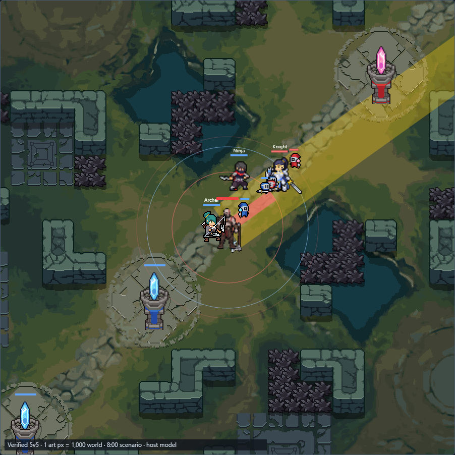
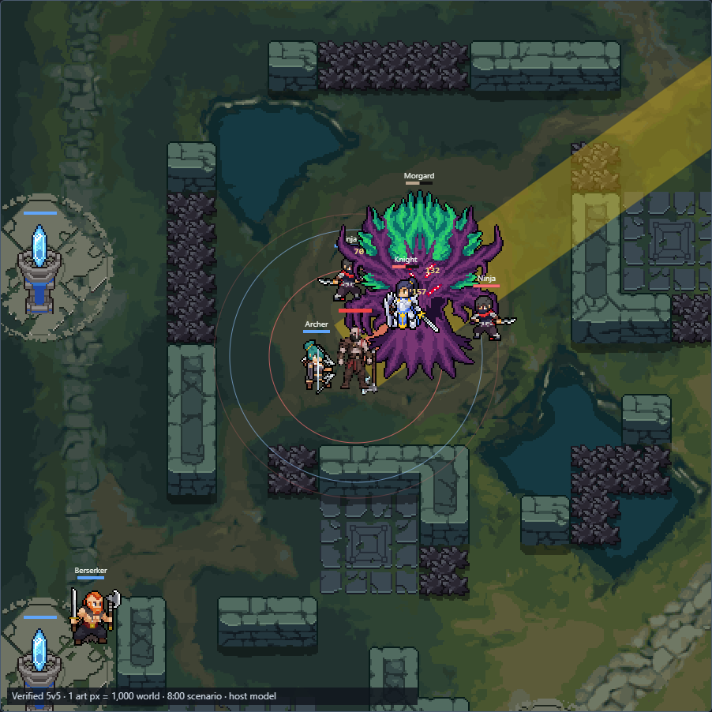

# Kratos Lab: installed battlefield and mid-game situations

This is the map-correction baseline. The later [kratos-2 skill revision](../kratos-skill-review/README.md) intentionally changes Kratos mechanics and presentation; earlier unchanged-core claims below refer to the map-only pass. Map registration, extracted stock assets and scenarios remain in use.

Verified on 2026-11-10. This follow-up replaces the approximate Lab backdrop registration and placeholder actors. **Kratos's native kit, AI, rules, core, WASM, approved pixels and packaged DLL are unchanged.** The browser host now supplies more useful situations; it is not the stock simulation engine.

## What was corrected

Levi's 30×30 collision grid was correct: all 900 cells agree with the installed native map export, including 90 blocked cells. Its background registration and estimated object placements were insufficient for a scale comparison.

| Quantity | Installed reference |
|---|---|
| Playable field | 960,000 × 960,000 world units |
| Collision grid | 30 × 30, 32,000 world units per cell |
| Original layered map PNGs | 1,280 × 1,280 pixels |
| Decorative source border | 160 pixels on each side |
| Playable source rectangle | x/y 160, width/height 960 |
| Registered scale | **1 original art pixel = 1,000 world units** |
| Draw origin for the complete map | −160,000, −160,000 world units |
| Champion radius | **10,000**, extracted from game settings; the old isolated fixture used 3,000 |
| Structures | All 16 towers and both nexuses at exported positions |
| Camps | Eight ordinary camp locations plus Morgard and Serpen |

The six original map layers are composited without resizing their source pixels. Foreground walls remain a separate layer. Every wall-cell centre agrees with the corresponding installed wall-layer pixel, and tower-pad landmarks share the same transform. Bodies, ranges and effects use that transform in this Lab. **This is asset/world registration evidence, not a live-engine camera or pixel-perfect rendering claim.** Native presentation metadata is unchanged in this browser-only follow-up.

Ordinary movement uses circle-versus-wall checks, swept travel and bounded route searches around walls. Diagonal routes cannot cut blocked corners. Chain Dash keeps its existing explicit wall-crossing exception. Other unit radii, unit collision behaviour and navigation are host models, rather than recovered engine implementations.

## Playable situations

Open [Kratos Lab](http://localhost:7302/kratos.html). Choose a situation and press **Load situation**:

| Situation | What to evaluate |
|---|---|
| Mid-lane wave / trading | Reach, wave clearing and trading around minions |
| Gank from the river | Entry angle, allied follow-up and an exit |
| Being ganked / countergank | Ninja's approach after two seconds; peel, turn or retreat |
| Assigned jungle camp | Rhino clearing and legal jungle farming |
| Morgard contest | Objective damage, zoning and peel in the actual pit |
| Serpen contest | Approaches, finishing the objective or turning onto champions |
| Defend a tower | Threatened wave, laner protection and punishing an overstep |
| Dive with an allied wave | Tower exposure, wave cover and disengagement |

Each starts at an explicit **8:00, level-eight snapshot**, adjustable by level, with skills ready and no items. There are ten champions including Kratos, eighteen minions, sixteen towers, two nexuses and ten neutral units: 55 actors besides Kratos, within the transport's 64-unit bound. Camp/objective HP uses extracted base values, with the contested objective at 60%; this does not claim to recreate native spawn-growth logic. Minion growth uses the extracted wave-growth settings, as a labelled model.

All sixty stock champion appearances and stat definitions can be selected. Click a champion and use **Replace selected champion**; the default replacement is the enemy Knight. Champions, lane minions, camps, bosses and structures use their original bundle PNGs and animation metadata. Actual lane minions come from the game's minion sheet, not recoloured champion bodies. Team colours and animation tags are preserved. Circles are optional collider/range overlays, not the actors.

Use the full-map overview, wheel zoom, 1× sprite inspection, middle/Alt-drag panning or minimap. These change the inspection camera only. Stock replacement and scenario resets load the corresponding real sprites. The inspector reports raw requested damage separately from HP/shield delivery and champion/wave/objective contribution.





## Read-only extraction and provenance

The editor server generates the ignored local cache `editor/game-reference/` from the installed game. **Original stock sprite sheets and map layers are not repackaged into the mod or committed here.** No executable, DLL, save or installed asset is changed.

Requirements: the installed `bundle.game_data`, a native `mods/tfm2_custom_ai/map_dump.json` export, Node, and Python with Pillow for the registration check. The server detects a missing/stale cache and rebuilds it. Missing references produce a visible error, with no silent approximate-map fallback.

```powershell
rtk proxy node editor/extract-game-world.js
rtk proxy powershell -NoProfile -File tools/start-kratos-review.ps1 -Restart
```

The extractor records hashes for each original asset and animation resource in local `world.json`. All 77 cached PNGs (six map layers and 71 stock actor sheets) match their recorded source bytes. Reuse across future Labs is supported by `game-world.js` and `lab-scenarios.js`; no other existing Labs are silently migrated by this change.

- Installed bundle size: **1,156,606,899 bytes**. Cache identity uses size/mtime and export SHA; no whole-bundle hash is claimed.
- Native map export SHA-256: `7a753de8001586b95dc9b1d4c385fda2d7de4a7e03863ee28a063d8879c186e3`.
- Original `map_setting` SHA-256: `6fee0c2b22905b5387976529d218f407efc5ca4ef9edb63d3f520a78eb8e9ca0`.
- `game_setting`, `champion_info`, English names, map layers and original `#anim`/`#sheet` resources are read from the bundle index. Exact lanes/camps/towers come from the installed native map export.
- The complete `map_setting` binary schema was **not decoded**. Raw wall/position patterns were not found; hashing that asset is provenance, not evidence of decoding it. Registration is established independently against the native export and all 900 wall samples. Regenerate/revalidate after game/map updates.

## Verification

| Check | Result |
|---|---|
| New battlefield/situation browser checks | **23 passed**, including all eight situations over 240 ticks each |
| Existing Kratos kit checks | **10 passed** using the explicitly labelled isolated mechanics fixture |
| Artwork/Lab checks | **27 passed**, including keyboard, pause/step, both server routes and recording replay |
| Art-on/off invariance | All eight mid-game core/host traces agree; existing 24 development + 12 holdout fixture traces also agree |
| Manual athlete independence | 13 attributes × 3 paired fixtures agree |
| Native/WASM agreement | **405 complete outputs equal** |
| Core/rules/WASM | Byte-identical to the original PR head |
| Canonical Kratos generation | Current |
| Wall registration | **900/900**, 90 blocked |
| Cached PNG integrity | **77/77 source hashes agree** |
| Missing reference | Explicit error; no Levi fallback |

Five matched browser runs used the 55-actor lane situation, Kratos AI enabled, 60 warmup ticks, then 600 measured ticks. Core-plus-modeled-host step p95 was **0.6–0.7 ms**; canvas drawing p95 **0.6 ms**, excluding DOM inspector updates. Five fresh-page navigation/asset loads were **165–215 ms** with the generated local cache. These are local Edge measurements, not native host or Magnus 128-piece acceptance. Detailed measurements and geometry are in [browser-results.json](browser-results.json).

```powershell
rtk proxy node tools/test-kratos-situations.cjs
rtk proxy node tools/test-kratos-lab.cjs
rtk proxy node tools/test-kratos-art.cjs
rtk proxy python tools/verify-kratos-art.py
rtk proxy python tools/generate-kratos.py --check
```

The fresh 27-check art/Lab rerun is retained in [art-browser-results.json](art-browser-results.json). The original art report and screenshot remain intact. The earlier full native/Mod Manager evidence remains in the [art review results](../kratos-art-review/results.md). No native code, champion definitions or package files changed in this follow-up, so that evidence is preserved rather than described as a fresh native run.

## Explicit limitations and release gates

Stock actors use real sprites, animation clocks and extracted stat/action definitions, but their **movement decisions, basic attacks, projectile timing, tower targeting, shields, physical mitigation and visibility are browser models**. Full stock skills, item builds, rewards, respawns and unit-unit collision are not emulated. Visibility withholds hidden current positions and HP from the custom core; spectator inspection does not grant AI vision.

Kratos's attacks and skills still run through his unchanged Rust/WASM core. Native Sight remains a healing refund; the Lab's idealised dodge does not prove reliable host pre-hit avoidance. Native Chain Dash's glide/hop and cage interaction remain live checks. Recordings preserve core-output verification; legacy/different-map recordings identify their saved layout rather than claiming current scenario fidelity.

The genuine stock engine is not running inside the browser. Actual-game alignment/combat acceptance, a new release DLL/version, packaging, installation and career migration remain separate. The new requirements are also saved in the existing Notion champion-creation/shared-systems guides and Kratos memory.
