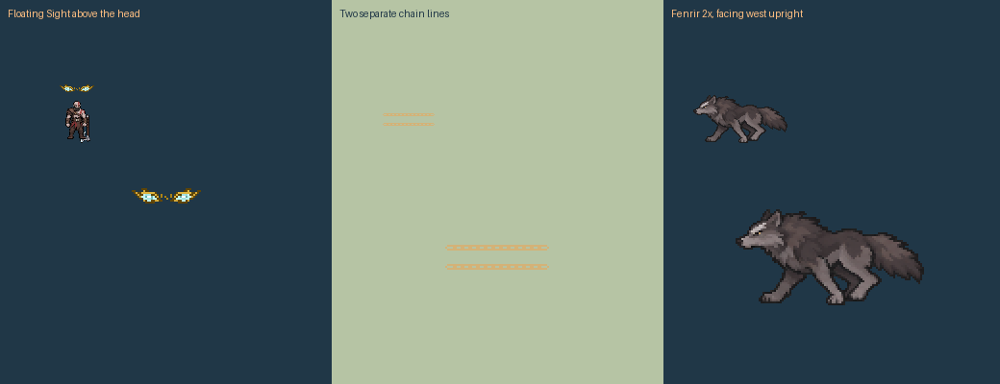

# Kratos skill revision — kratos-2

Requested and effects approved on 2026-11-10. This supersedes the original short Rampage and waiting-wolf behaviour. Kratos's body/weapon pixels, base stats, Mod Power, damage formulas, cooldowns, target exclusions and shared three-second CC-immunity cap are preserved. Range, timing, wolf geometry, recast aiming and linked Guard control change as requested.

| Action | New prototype behaviour |
|---|---|
| Fenrir arrival | Up to **320,000** away, appearing on open map ground along the aimed direction. Fixed world distance, independent of Lab zoom/camera. |
| Fenrir size | Twice the prior raster size: **50 visible pixels high**, 160×160 padded phase frames. Collision half-width **24,000**, matching a 48,000-wide swept corridor. |
| Fenrir motion | Runs through the cast position toward a point 160,000 beyond it; fades at path completion or the three-second recast expiry. No parked/idle phase. |
| Fenrir recast | Aim anywhere, then press **4** near the wolf. Up to 15,000 leap, 39,000 catch reach including the wolf's body; redirects it up to **320,000** in the committed aim direction. Same one-hit-per-leg damage/knock-up. Aimed return cannot replace another committed technique. |
| Rampage | **108,000 total travel**, three 36-tick stages: **1.8 seconds**. AI engage reach 80,000; swings 26,000 radius; finisher 32,000. Terrain still stops advances and blocks attacks through walls. |
| Rampage weight | Existing whole-body drawings with longer anticipation and recovery. Contact at tick 18 of each stage aligns with the held-weapon impact frame. No hit-stop or cosmetic idle locks. |
| Chain Dash | Two separate linked chains, aligned to the existing 55,000/90,000 line and eight headings. Damage remains one packet. |
| Heimdall's Sight | Original gold/cyan floating eye pair above the head for the actual 1.5-second window; replaces the bump/rune ring. No additional reveal or vision. |
| Dash → Guard | After a **connected** Dash within the existing link window, Guard also taunts eligible enemy champions within **36,000** for **0.75 seconds**. Missed throws, ordinary Guard, allies, towers and creeps cannot trigger/receive this taunt. Native uses the engine's Taunt control with Kratos as its target. |

These numerical changes are implementation prototypes chosen to realise the requested direction, not externally verified balance targets. The first/return wolf speed stays 2,400 units per tick; the longer path gives time to see the approach. Running drawings use stable phases, and west-facing travel mirrors the wolf instead of turning him upside down.

## Approval and original assets

Reihan approved the actual-size comparison: **“Approve the revised effects.”** Approval and the new source hash are in `docs/kratos-art-review/approvals.json`. The original Kratos/Fenrir appearance approvals remain intact. The eye source was produced with the built-in imagegen tool; original source and edit prompts are in [prompts.md](prompts.md). Twin-chain geometry extends the existing code-native link artwork. Larger cleave/fire/impact materials and wolf drawings derive from the frozen approved sources.



The body and weapon PNG hashes are unchanged from `ef6b275`; approved existing poses are retimed for the requested heavier Rampage. All three packaged atlases match the review assets. Decoded owned artwork is **28 MiB**, within 32 MiB; maximum atlas edge **2048**. Packing/extraction is reproducible from frozen sources; AI generation is not claimed deterministic.

## Lab controls

Open [Kratos Lab](http://localhost:7302/kratos.html?build=kratos-2) or the [animation review](http://localhost:7302/kratos-review.html?build=kratos-2). Existing real-map/stock-actor situations remain available.

- **4:** call Fenrir; **4 again nearby:** redirect toward the mouse. The cyan line previews the return and the catch circle shows the allowed reach.
- **2:** long Rampage; **R:** redirect the next advance.
- **E**, then **3** after connecting: Chain Dash → taunting Guard.
- **1:** Sight, with eyes above the head.

The inspector shows wolf gap/catch reach and the taunt rule. The Fenrir demo follows the moving wolf and recasts at contact, rather than assuming his old arrival tick. Previous recordings remain inspectable; replay requires their original rules revision.

## Verification and limits

The focused [browser report](browser-results.json) checks heavy travel/impact timing, far moving approach, a perpendicular return into an off-axis enemy, taunt delivery/forced target in the host model, twin-chain separation, approval integration and atlas budget. [Verification](verification.json) compares **405 existing + 431 focused complete native/WASM outputs**, verifies unchanged body/weapon PNGs and checks all 817 packed frame references.

The existing 10 kit, 27 art/Lab and 23 map/situation browser checks pass, including 24 development/12 holdout fixture traces and all thirteen manual athlete comparisons. The full GNU Windows native suite passes **1,149 tests**, including the explicit native Taunt recipient test; **13 remain ignored** and four inherited dead-code warnings remain. Both Lab transport tests pass. Isolated Mod Manager verification compares **878 identical files**, with no missing/different assets or real-game installation.

```powershell
rtk proxy python tools/build-kratos-art.py
rtk proxy python tools/generate-kratos.py --check
rtk proxy node tools/test-kratos-rework.cjs
rtk proxy node tools/test-kratos-art.cjs
rtk proxy node tools/test-kratos-lab.cjs
rtk proxy node tools/test-kratos-situations.cjs
rtk proxy python tools/verify-kratos-rework.py
rtk proxy python tools/check-kratos-repro.py
```

Native source uses supported damage/control/force-move/effect APIs; the browser models stock behaviour. Actual-game taunt targeting, wolf/cast alignment, wall-hop presentation and Sight's healing-refund limitation still need live acceptance. **The packaged DLL remains the inherited baseline; no new release DLL, installation or career migration is claimed.** Build/version/package separately before installed-game readiness.

Visual references: [Riot's official Sylas ability presentation](https://www.leagueoflegends.com/en-us/champions/sylas/) informed the twin-chain direction. Martis-style advancing swings are the user's supplied design reference; this pass does not claim frame-accurate reproduction of his animations.
