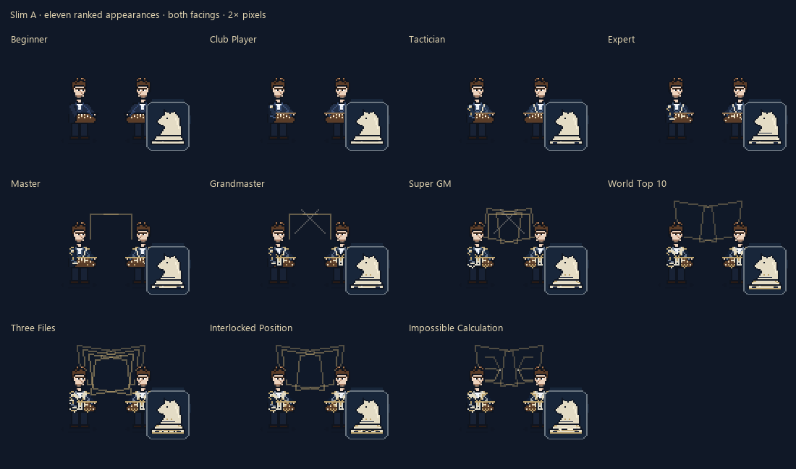
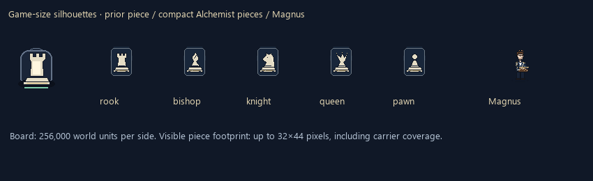

# Magnus ranked chess and Vesper verification

For native 0.10.54 / champion pack 0.2.55 and the current measurements, see [Magnus practical planning and reliable farming](magnus-grandmaster-farming.md). This document records the previous 0.10.53 / 0.2.54 release; its embedded tables are historical.

Date: 16 October 2026 (Asia/Jakarta). Isolated branch `codex/magnus-mate-scale-vesper-perf`, based on `30f2969`. The original checkout and its uncommitted work remain untouched.

## Implementation

Native **0.10.53**, champion pack **0.2.54**, dependency **>=0.10.53**. Chess Lab transport is **version 3**, using the same Rust core as gameplay.

Magnus has eleven Slim A appearances and seventeen animated emblems. Body/outfit, emblem and calculation layers keep separate clocks. Actual search continuations supply PLAN markers; #1 can show up to three genuine candidates. The compact native display uses a target-centred 4×4 window with edge markers; Chess Lab lists full map coordinates. Hidden, moved or captured targets invalidate the preview. Manual practice displays its submitted command. Rendering performs no search or gameplay RNG calls.

The shared grid is **32,000 units** per square, making the board **256,000 units** wide. Pieces use **Alchemist**; Frieren's Ghoul/Stark override is preserved. The complete visible masking footprint is at most **32×44 pixels**, including margins needed to hide the carrier's active poses. Ultimate deployment requires the Magnus-specific learned marker at planning, preparation and commitment. Existing campaign copies without `passive_ult` require a data migration before they can supply this marker; a fresh champion definition includes it.

Pawns take one cardinal travel step and cannot immediately return. Forced yields update previous-square history but add no promotion ranks. Only newly reached forward ranks plus confirmed champion damage qualify promotion. Diagonal combat attacks and adapted en passant remain. Sliding paths, commitment occupancy, map-wide summons, persistent losses, fade/re-entry, damage dilution, shared command timing and twelve historical adaptations remain in the common core.

The search applies each branch sequentially, prioritises viable mating nets, and keeps a completed trap stationary through its warning. It considers at most sixteen rotating tactical pieces, sixty-four evaluated candidates and beam width eight. Cached destination scores avoid repeated expensive sorting work. Appearance changes never alter identical manual combat commands.

## Visual review

[Beginner / Master / #1, all poses and facings](magnus-ranked-poses.png) · [All seventeen emblem clocks](magnus-emblems.png)

Magnus decodes to **30.34 MiB**, across 74 atlases, each no larger than 2048 pixels per side. One symmetric crop per animation retains its centre anchor. Exact duplicate frame storage is shared. The artwork verifier checks 440 piece frames against the Alchemist silhouette and 11×8×8×2 outfit/pose/frame/facing combinations. All 154 canonical generated files reproduce byte for byte.

## Automated verification

- Native release suite: **351 passed, three existing diagnostic tests ignored**; 78 Magnus tests.
- Mod Manager: **13 passed**.
- **9,638 complete native/WASM parity frames**, including all twelve successful historical replays, all mastery ranks, every numbered Top 10 badge, ultimate locking/unlocking, manual and automatic commands, and independent concurrent instances. Comparison includes internal state, RNG, cooldowns, roster, preview paths and emitted commands.
- Historical near misses cover missing events, hidden targets, interruption, cleanup and duplicate damage receipts. Mate fixtures cover preparation before damage, holding the warning, terrain and safe exits, immunity and survival castling.
- Pawn tests cover four-way travel, immediate-return rejection, loops, forced yields, capture geometry and promotion qualification. Reset/death, persistent armies, ownership and dynamic roster tests remain enabled.
- Chess Lab browser replay: Opera completed with a 1.25-second stun and 12-second immunity. With motion and enemy attacks enabled, all three enemy positions remained unchanged during two half-second steps while stun counted down. The lab includes rank/podium controls, pose/facing/frame inspection, actual continuations and the ultimate checkbox.
- Vesper's timing observer preserves all commands and gameplay state across eight mastery ranks. The existing wall-clock diagnostic field is excluded from deterministic state comparison.

### Development and holdout scenarios

| Set | Seeds | Mean living fraction | Checkmates | Historical rewards | Raw piece damage |
| --- | ---: | ---: | ---: | ---: | ---: |
| Development | 24 | 0.733 | 49 | 0 | 65482 |
| Holdout | 12 | 0.731 | 24 | 0 | 34411 |

Autonomous historical completion remains zero in these controlled scenarios. All twelve manual sequences pass; autonomous execution needs more tuning. These scenarios include deterministic moving enemies and piece damage, but exclude renderer and item behaviour.

### Release core stress

| Army | p95 step ms | p95 planning decision ms | Slowest step ms |
| ---: | ---: | ---: | ---: |
| 32 | 0.019 | 0.399 | 1.866 |
| 64 | 0.020 | 0.586 | 2.259 |
| 128 | 0.039 | 3.515 | 3.515 |

The 128-piece p95 step meets the <4 ms target; the separately reported planning-decision p95 also meets it in this run. These are development-machine release-core measurements, not crowded-match FPS.

## Vesper

See [the pixel/timing audit](vesper-animation-equivalence.json), [host timing summary](vesper-host-profile.json), and [performance notes](vesper-performance.md). All **1,132** animations preserve exact decoded pixels, dimensions, frame order and duration. Full decoded storage falls by **13.51 MiB**; the largest atlas is **4 MiB**. No effects, lifetimes, RNG outcomes or detail levels were removed. New opt-in timings separate snapshot, planning, core, host calls, visual sync and effect-tag bursts, scoped to each passive instance.

## Actual game observations and release blockers

The game loaded native 0.10.53 in game 0.6.4. A lane composition simulation and replay showed compact knight, pawn, bishop, rook and queen silhouettes, rank clothing, warnings and PLAN. Field summons appeared at level 1. The observed campaign had an older embedded champion definition and therefore did not establish ultimate-marker unlocking or active-board acceptance.

These game observations used an earlier 0.10.53 build (DLL `721c1a3e1a318829e1a4acf1b390e0b46b033414cfe47cced5e9571ba38f289b`). The final packaged DLL includes subsequent preview-legality validation and has not received a new rendered-match acceptance run.

The corrected two-piece diagnostics recorded a targetable, commanded Alchemist knight dropping to **24.5% HP**, with 24 distinct sampled positions. The pawn was targetable at 13 sampled positions; it remained full HP in the recorded samples. These are actual-engine diagnostics from mixed simulation contexts, separately recorded in [the carrier probe](magnus-carrier-probe.json). Pawn HP loss, suppression of autonomous attacks, complete death cleanup, final seven-piece board deployment, items, kill attribution, farming and crowded custom-champion interactions remain unaccepted.

**Historical hit confirmation is a release blocker:** synchronous HP/shield reads immediately before and after the native damage call returned zero deltas in the observed host. The core deliberately refuses to grant promotion/history progress from unconfirmed hits. A reliable host damage acknowledgement still needs investigation; raw requested damage must not be substituted as proof.

Vesper's new-build native timing samples are useful diagnostics, but the captured origins were Unknown and ServerPresim. There is no comparable pre-change/cold/warm rendered-match baseline, so **the freeze is not claimed fixed**. Renderer decode/upload stalls and crowded visible fights remain to be measured.

The PR is a draft while these acceptance items remain open.

## Package and installation

DLL SHA-256: `9f64e636cc7b68ae0104d996113cfed48d86d6db24447394079d5a66737e445c`. The packaged DLL matches its release output byte for byte; native metadata and champion dependency agree.

Mod Manager checked **773 files, zero different, zero missing, identical DLL** in both the installation fixture and the actual game folder. The full build was installed only after the game closed. The temporary global carrier probe and timing flag were removed. A labelled disposable campaign copy remains with ordinary Magnus settings. The original campaign matches its pre-test backup byte for byte. The original checkout remains unchanged.

## Reproduce

Prefix shell commands with RTK. Build the native crate and vector binary in GNU release. Build the Magnus Lab library for `wasm32-unknown-unknown` and copy it into `editor/magnus.wasm`. Run `tools/run-magnus-verification.py`, `tools/verify-magnus.js`, `tools/verify-magnus-art.py`, `tools/verify-magnus-generation.py`, `tools/review-magnus-art.py`, `tools/verify_vesper.py`, `tools/verify-vesper-animation-equivalence.py`, `tools/package-magnus.py`, `tools/check-magnus-package-manager.py` and this recorder. Mod Manager's `--install` installs the current review branch without pulling/switching to main; `--update` retains its existing update workflow.
