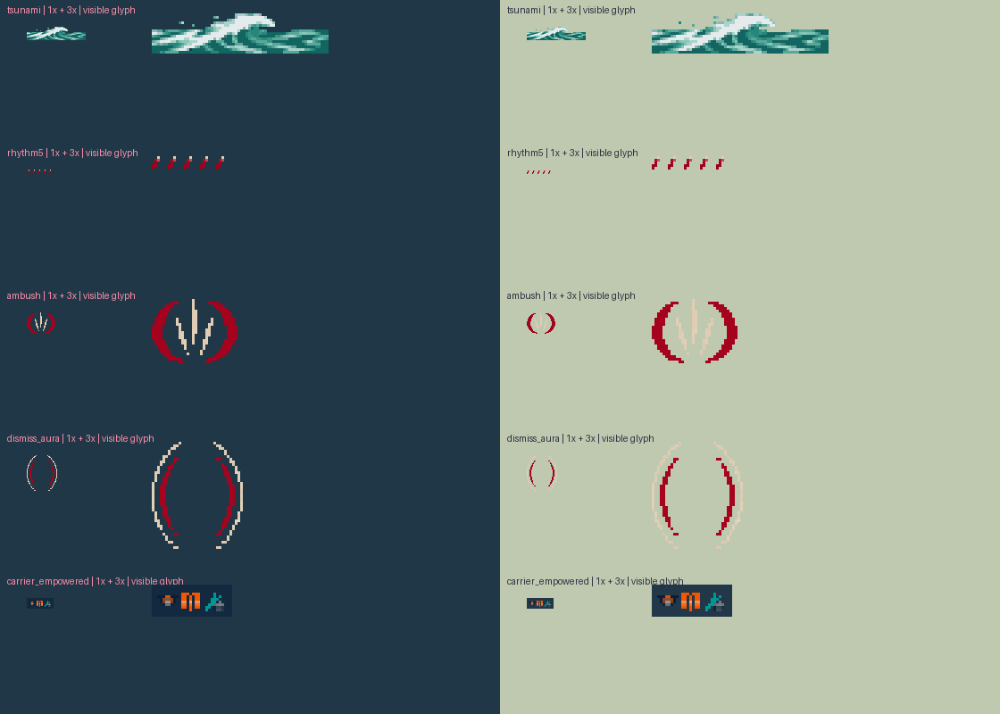

# Approved Round 165 effects

Reihan approved the corrected artwork on **2026-11-12**: “Approve the corrected artwork.” This covers Thalassa’s tsunami, Akane’s Rhythm/Ambush/Dismiss feedback and Wright’s carrier indicator. It does not establish actual-game acceptance or authorize installation.

This branch incorporates Claude’s latest **akane-1.3** commit a0171ba35822a6726533076c790f564b9036d97c. Earlier counts in the main review describe their original checkout.

## Result

- Thalassa uses ordinary land bolts and a **water-only** rectangular tsunami, including the existing wet/Dive water state. Owner water basic range is a prototype **82,500**, up from 66,000; land stays 55,000. The two-second basic clock, damage, knock-up lock and clone single-bolt behavior remain. Clone water range retains +20%.
- Akane’s one-to-five Rhythm pips, Ambush and Dismiss aura follow authoritative status lifetimes. Her body, original effects and akane-1.3 gameplay remain intact.
- Wright’s carrier shows a small three-skill empowerment panel above HP/guard displays. Bomber warnings/explosions reuse approved pixels at **30,000 radius**, with **60/96/132-tick** warnings. His body, fleet and wright-6 mechanics remain intact. No extra carrier summons or radius buff is introduced.

Original sources were generated with built-in imagegen. **prompts.json** records exact prompts. Source v1 is retained as the input to transparent-background cleanup; v2 and the accents sheet are frozen by **frozen-sources.json** and **approval.json**. AI generation itself is not deterministic.

## Native and Lab presentation

One generated manifest drives the auxiliary native atlas, bindings and Lab selectors. Existing aliases remain compatibility fallbacks; **r165_art:1** opts new Thalassa/Wright definitions into new selectors. Akane binds existing authoritative status names directly.

S1’s original tls_surge is preserved. Only the **18-tick basic tsunami** selects the new wave, reconstructing its path from the owner origin and committed midpoint. There are 32 headings (maximum quantization 5.625°), nine length banks at the existing 950-units-per-pixel scale, and bounded segmentation. Damage uses the exact core rectangle; banks approximate its heading/length. Single-frame persistent statuses cannot restart animations on renewal. No animation CC or movement restrictions are added.

The Thalassa Lab F-key host model now uses the canonical 120-tick basic clock, 12-tick release and bolt speed instead of its inherited 40-tick flat-damage shortcut. It does not prove engine items, mitigation, targeting or collision.

Review: editor/round-165-art-review.html. All three playable Labs load actual packaged assets. Installed-map/stock references require the ignored local editor/game-reference cache; stock game assets are not redistributed here.

## Packing and memory

Legacy Thalassa FX shrink from padded 1536×1536 to **1024×436** by symmetrically removing transparent padding. All **252** frames reconstruct exactly, including RGBA and duration, at their original world centre. All three bodies, Akane/Wright’s legacy FX and Thalassa’s link sheet remain unchanged.

Auxiliary atlas: **2048×1623**. Each total conservatively includes that entire allocation.

| Owner | Total decoded bytes | Limit |
|---|---:|---:|
| Akane | 17,489,920 | 33,554,432 |
| Wright | 25,190,400 | 33,554,432 |
| Thalassa | 33,005,568 | 33,554,432 |

All atlases fit 2048×2048; **4,986 frame bounds** pass.

## Reproduction

Run from the repository root with Python/Pillow and Rust GNU Windows:

    rtk proxy python tools/prepare-round-165-art.py
    rtk proxy python tools/build-round-165-art.py --integrate
    rtk proxy python tools/generate-akane.py
    rtk proxy python tools/generate-thalassa.py
    rtk proxy python tools/generate-wright.py
    rtk proxy python tools/generate-roster.py
    rtk proxy python tools/verify-round-165-art.py
    rtk proxy python tools/package-round-165-art.py
    rtk proxy python tools/check-round-165-art-manager.py

Existing champion art builders reapply the approved supplement after legacy regeneration. Integration refuses missing/mismatched source approvals. Verification rebuilds and compares hashes.

## Automated and Lab evidence

- Windows native suite: **1,202 passed, 13 ignored, zero failed**. Four inherited test-only dead-code warnings in native-bridge detour fixtures remain; release DLL builds succeed.
- Lab crates: Thalassa **45**, Wright **29** (28 unit + one isolation), Akane **9** (two transport + seven range).
- Existing browser suites: Wright **12**, Thalassa **10**, Akane **9** passed.
- Supplemental browser suite: **23** checks, including every supplemental frame, root/direct routes, water-only basics, warning clocks, cleanup and art-on/off complete combat traces.
- Complete native/WASM output equality: **360 Wright + 360 Thalassa + 3,240 Akane frames**.
- Akane actual-map browser suite: **37** checks, including 24 development/12 holdout art-on/off fixtures, all 13 stats at 20/80 across three manual fixtures, recordings and keyboard/focus.
- Five-run Lab core+host step p95: Wright about **0.10 ms**, Thalassa **0.10–0.20 ms**. Akane’s gank step p95 **1.10–1.30 ms**, draw **0.50–0.80 ms**. These are browser measurements, not Magnus’s native 128-piece benchmark or actual-game performance.
- First-page readiness: Wright **94 ms**, Thalassa **65 ms**; Akane’s three cold-page runs **198–222 ms**. Browser caches affect these figures.
- Canonical generators and reproducible packing pass.
- Isolated Mod Manager: **885 files compared, no differences**, successful exit, private APPDATA/disposable fixture only.

Machine-readable reports: verification.json, browser-results.json, akane-browser/browser-results.json, akane-browser/native-parity.json, mod-manager.json and package.json. Earlier evidence directories remain historical.

## Package and remaining acceptance

Retain unmerged release reservations native **0.10.99**, champion pack **0.2.102**. Two independent target builds with a fixed SOURCE_DATE_EPOCH reproduce this repository-packaged DLL SHA-256:

    31d966664c5117363c8cb7414d7d4ec64c8df4b5635a73a32296c22e94de7475

The package script does not install. Saved definitions require the existing backed-up inspection/migration workflow to gain new bindings; older definitions retain fallback art. No real career changed.

**Actual-game acceptance remains pending:** wave attribution/geometry, killing-hit behavior, clone isolation, both facings/crowded fights, status visibility, carrier guard/indicator, supported damage-receipt calibration and item interactions. No new vision, aim bias or stock-engine targeting control is claimed.

