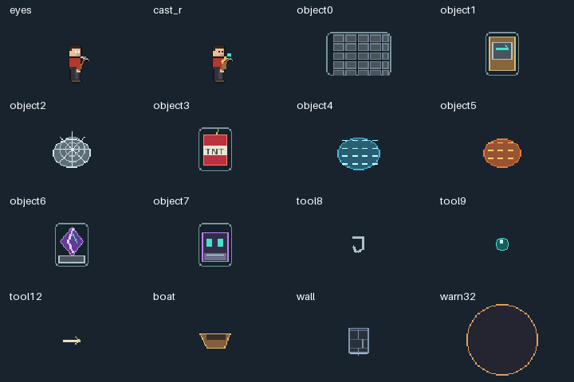
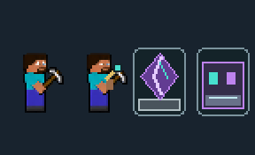

# SteveCraft: Steve / Herobrine

This branch implements the agreed crafting rework on `codex/steve-herobrine-crafting`, based on `0161dfa`. Steve keeps his original champion ID, stats, growth, body pixels, animation metadata and normal attack timing. Native rules advance to **0.10.61**; Blockcraft advances to **0.1.20**. The saved [Omen teleport proposal](omen-teleport-ai-plan.md) has no Omen runtime changes in this branch.

## Implemented rules

- Fifteen recipes share three independently recovering five-second charges. Build and utility groups follow their engine skill unlocks. Acceptance commits the charge and individual cooldown; interrupted preparation is not refunded.
- A crystal or anchor occupies one prepared pocket and reserves two charges indefinitely. Deployment starts recovery and the recipe cooldown. Discard, interrupted preparation and death release those reservations into ordinary recovery. Failed native object allocation restores its paid charges/cooldown and never leaves an invisible damaging object.
- Steve improves healing/shields by 20% and newly built object HP by 25%. Herobrine earns one four-second, champion-bound melee follow-up from a confirmed visible utility hit. Bonus damage uses the skill route, while the ordinary attack has exactly one base-attack identity. No mastery, spell locks by rank, or ranked appearance sets are added.
- Change Form is a separate 0.4-second native action with a twelve-second base cooldown after ultimate unlock. It does not spend or reset the Boat Wall ultimate.
- Boat Wall has a half-second committed-path warning, an 80-second base cooldown, at most 300,000 units of path and sixteen segments. Steve builds straight; Herobrine supports signed 45/90/135/180-degree open arcs. The empty boat continues after dismount. Ram hits are deduplicated across the whole ride, use local segment normals and retain twelve-tick knockback. V1's parry breaks the entire ultimate wall. Normal damage does not break the large wall.
- The shared movement hook routes around the union of wall segments and leaves attacks/casts alone. Collision, fog, warning and rendering use the same committed segments. Proposed walls reject terrain-shortened paths below 60,000 units, narrow openings and allied positions without an escape route.
- Destructible small walls, pistons, TNT, crystals and anchors use targetable Alchemist carriers with zero attacks, movement locks, owner markers and explicit cleanup. Web/water/lava remain visible timed fields. Prototype HP is 20% owner HP for a small wall, 15% for a piston and 10% for an explosive, with 15 armour/MR before Steve's object bonus.
- Heavy blasts have a fixed 0.6-second warning, deal half their listed raw damage to their owner before normal mitigation/shields, and respect terrain and constructed walls. A destroyed crystal warns then explodes; a destroyed anchor defuses. Expiry, cleanup and death never explode. Heavy explosions do not hit other gadget carriers and cannot recursively detonate them.
- The rod retains charged reach, ally rescue, enemy reel, terrain grapple, TNT rethrow and pearl/tether relocation. TNT keeps its throw, landing fuse, mine trigger, nearby-swing acceleration and twelve-tick knockback. Short boat ice remains for three seconds; its rider has no ultimate immunity.

The recipe catalogue, cooldowns, geometry limits and damage/support constants are canonical in [the rules file](../rules/steve-craft.json). `tools/generate-steve-rules.py` generates the native and editor definitions. The Rust core has no host handles, clock or gameplay RNG. Its bounded search generates the complete catalogue, considers at most 128 branches, uses a three-action horizon and keeps eight continuations. Herobrine gives a safe grouped-target explosive preparation a meaningful planning value; defence and visible targets are revalidated.

## Lab and artwork

Open **SteveCraft Lab** from the editor or Steve's Skill Test. It uses `editor/steve.wasm`, compiled from the same core as native gameplay. It exposes all recipes, the prepared pocket, independent form/wall clocks, signed curves, dismounting, destruction, interruption, fog and complete replay verification. The recording limit preserves the first 12,000 frames so exported recordings always start with a fresh core.

Transport v1 uses bounded integer frames and owner-local session handles. Inputs include unlocks, control, snapshots, actual basic impacts, object HP/allocation acknowledgements, damage receipts, terrain rectangles and external wall segments. Output includes commands, public state, actual selected continuations and a complete deterministic core-state representation for native/WASM comparison. A supplied impact is a confirmed event, not a request to hit.





The original body and legacy VFX are preserved. New mirrored eye/tool overlays, charge/reservation HUD, voxel objects, field art and warnings use a deduplicated **1024×309** atlas. Total decoded Blockcraft art is **2,065,408 bytes**, below 32 MiB. `tools/verify-steve-art.py` checks reproducibility, both overlay facings, every atlas rectangle, and unchanged original animation metadata/pixels.

## Verification and limits

Automated results and package evidence are stored in [steve-results](steve-results/). Shared-core tests cover every recipe, independent charges, reservations, interruption, form/cooldown persistence, allocation failure, target-bound follow-ups, immunity/fog, owner self-damage, cover, explosive cleanup, wall geometry, dismount, parry and union routing. Stable-ABI fixtures check one primary base attack plus skill-route bonuses and no qualifying event from invulnerable impacts.

The browser test runs all fifteen manual recipe previews and replay checks, then **24 development and 12 holdout scenarios** with full native/WASM state and command comparison. These are deterministic synthetic skirmishes, not balance win-rate measurements. The lab uses an explicit simplified damage/shield model and cannot establish engine item interactions, kill attribution, carrier targeting or host performance.

The full debug suite also exposes five **pre-existing Unified overflow failures at `unified_core.rs:2089`**. All five were reproduced on unchanged main using a separate build target. This branch does not change Unified's controller, equations or RNG to hide those failures. The two pre-existing test-only dead-code warnings concern Coder and Magnus fixtures.

Steve's release benchmark runs five repetitions at 16, 64 and 128 units, reporting each run's p95/p99 and the median. Curved route computation is measured separately. Magnus's unchanged 32/64/128-piece stress fixture is rerun against its existing under-four-millisecond p95 target. Host simulation, first-use rendering and crowded-match timing require live observation.

**Real-match acceptance remains pending:** carrier targeting and appearance, item interactions, attribution, rescue/tether collisions, knockback, warnings, curved-wall fog/collision, V1 parry and crowded fights. No game installation or user career was changed. No freeze or balance improvement is claimed from browser/core checks.

## Build, package and career migration

Run the following from the implementation checkout (all commands use the workspace's RTK wrapper):

```text
rtk proxy python -X utf8 tools/generate-steve-rules.py
rtk proxy python -X utf8 tools/generate-steve-art.py
rtk proxy python -X utf8 tools/verify-steve-art.py
rtk proxy rustup run stable-x86_64-pc-windows-gnu cargo test --manifest-path native/steve_lab/Cargo.toml
rtk proxy rustup run stable-x86_64-pc-windows-gnu cargo build --release --lib --target wasm32-unknown-unknown --manifest-path native/steve_lab/Cargo.toml
rtk proxy rustup run stable-x86_64-pc-windows-gnu cargo build --release --bin steve-vectors --manifest-path native/steve_lab/Cargo.toml
rtk proxy node tools/test-steve-lab.cjs
rtk proxy python -X utf8 tools/package-steve.py
rtk proxy python -X utf8 tools/check-steve-package-manager.py
```

Copy the resulting WASM library to `editor/steve.wasm` before browser verification and packaging. Start the isolated editor on port 7282 for the supplied browser test. `package-steve.py` pins `SOURCE_DATE_EPOCH` to the baseline commit, builds in two independent target directories and refuses to package unequal DLLs. Its report records the tested, reproduced and packaged hashes. Mod Manager verification uses a complete isolated fixture; it does not install into the user's game.

Existing careers retain their embedded definitions until explicitly migrated. `tools/migrate-champion-reworks.py <career>` is inspection only. `--output <new-file>` writes a new copy; `--in-place` verifies a full backup before an atomic replacement. Steve migration replaces only ability/controller/view definitions and preserves base stats, growth, items and history. Unknown passive bindings abort the entire migration. Repeating migration is a no-op. Keep the reported backup to restore the original career; never overwrite a career that has subsequently progressed without choosing which history to retain.

Publication, installation and career migration remain separate steps. Install only after closing the game.
