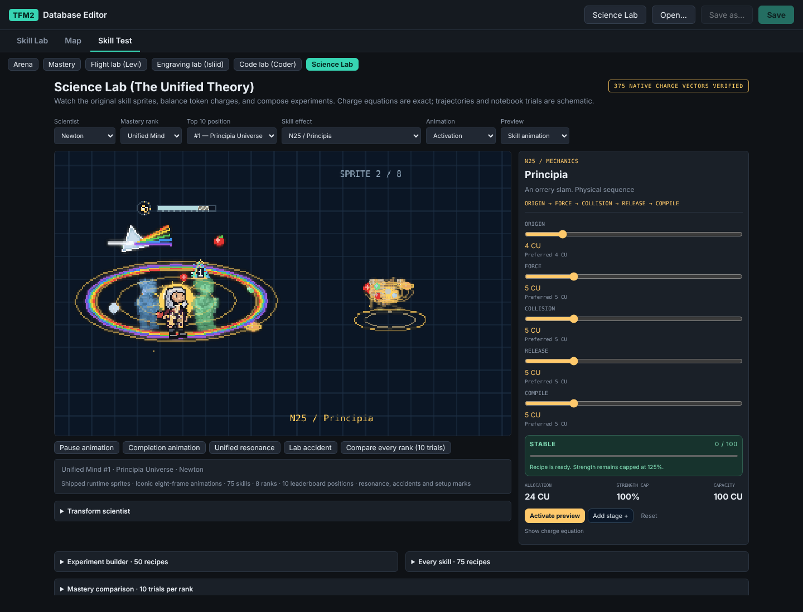
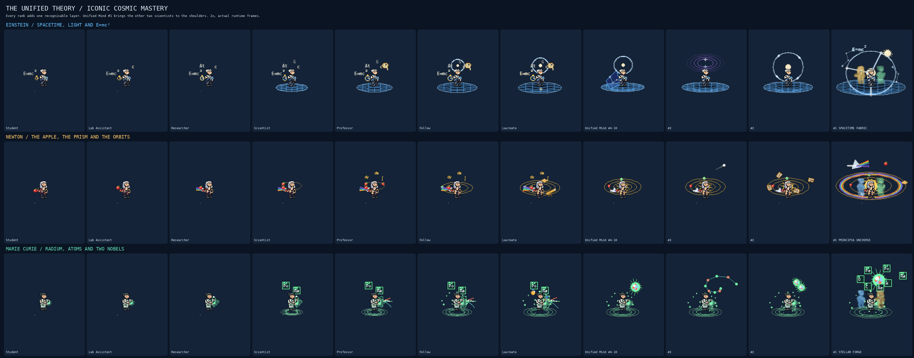

# The Unified Theory

Einstein, Newton and Marie Curie share one champion: one body, health pool, inventory, action queue and three-charge bank. All **75 skills** are available at every mastery rank. The athlete chooses experiments, writes their symbolic activation recipes and commits their effects.



Open the Database Editor with Mod Manager option **3**, then click **Science Lab** in the top bar, or select The Unified Theory in **Skill Test → Arena**. The lab now uses the same Skill Test workspace as the other mastery champions. It provides every activation recipe and per-token recipe weight, a five-stage experiment builder, 50 templates, imbalance feedback, a playable practice arena and deterministic mastery comparisons. [Complete skill catalogue and 50 recipes](unified-theory-catalogue.md).

**Science Lab** combines the original eight-frame animations for all 75 skills with their token charges and experiment tests. Its compact controls, large canvas, side panel and action buttons use the same shared layout and stylesheet as Coder and Isliid. The default **Practice arena** supports right-click movement, cursor aiming, target locking and casts. Select **Animation inspector** to inspect isolated sprites. Casting a skill or experiment selects the arena automatically. Only the selected preview runs, and both stop when the lab is hidden.

The lab includes eight ranks, every Top 10 position, activation and supported travel/field effects, transformations, completion, a searchable skill list, 50 experiment recipes and ten-trial mastery comparisons. Rank, form and skill selections carry back to the arena. **Mastery** lists athlete points and ranks, including Unified Mind #1–#10; its generator can randomize ranks or pin selected athletes and podium positions. These controls use the scientist's own `unified_theory` memory and pending files. **Skill Lab** links directly to Science Lab and the mastery generator; each of its 75 recipe rows opens that skill in the same lab. Notebook entries and animation pause state survive tab changes. The standalone `/science.html` page remains available.

[Science Lab preview](unified-theory-science-lab-ui.png) · [Playable arena preview](unified-theory-playable-embedded.png) · [Mastery list preview](unified-theory-editor-mastery.png) · [Current editor verification](unified-theory-science-lab-ui-verification.md).

## Visual identity (round 125: iconic and cosmic)

Each scientist is drawn through what they are known for, on a cosmic scale. The compact 18–23 × 37–38 px bodies, faces, gaze, hands and planted feet are unchanged; everything around them was redrawn in `Claude outputs/unified_theory/iconic_art.py`.

- **Einstein:** electric blue and violet light. E=mc² written in chalk, his pocket watch, a melting clock for slowed time, spacetime grids that ripple and dent, and Einstein rings.
- **Newton:** gold plus a full rainbow. The apple, the prism splitting white light, planets on elliptical orbits, his reflecting telescope, Halley's comet and Principia pages.
- **Marie Curie:** radium green with its glow. Glowing vials, Bohr atoms, Ra and Po element tiles, the alpha/beta/gamma ray diagram and her two Nobel medals.

**Rank is visual only.** Every rank adds one recognisable layer, and the aura grows from Student to #1. The verifier enforces this growth.

| Rank | Einstein: spacetime | Newton: gravitation and light | Curie: radioactivity |
|---|---|---|---|
| Student | Chalk E=mc² and pocket watch | Apple in hand | Faintly glowing vial |
| Lab Assistant | Chalk equations orbit his head | Apple tossed and caught | The vial's glow brightens |
| Researcher | Light trail from the watch | Prism with a thin rainbow | Bohr atom orbits the vial |
| Scientist | Spacetime grid under his feet | Apples orbit like moons | Ra/Po tiles, radium glow pool |
| Professor | Melting clock floats beside him | ∫, dy, dx glyphs and a wider rainbow | α/β/γ ray fan |
| Fellow | Einstein-ring halo | Apples become planets on orbits | Radium glow cloud |
| Laureate | A star dents the grid | Reflecting telescope and planets | **Two Nobel medals orbit her** |
| Unified Mind #4–10 | Spacetime-sheet cape with constellations | Miniature solar-system orrery | Atom-star: a nucleus glowing like a sun |
| #3 | Binary stars with gravitational-wave ripples | Halley's comet | A spiralling decay chain |
| #2 | Einstein cross (four lensed images) | Principia pages flutter into orbit | Twin fusing stars |
| #1 | **Spacetime Fabric** | **Principia Universe** | **Stellar Forge** |

At **#1**, the other two scientists stand at the active scientist's shoulders as translucent figures: three minds in one body.

- **Spacetime Fabric:** a warped grid, a ring of orbiting light, a small sun and E=mc² written in starlight.
- **Principia Universe:** a gold orrery inside a rainbow ring, a giant prism, the Moon "falling" on its orbit and an apple dropping.
- **Stellar Forge:** a sun-like nucleus forges H, He, C, O, Fe, Po and Ra, which spiral outward.



[Eight-frame animation of all ranks](unified-theory-ranked-cosmic.gif) · [#1 appearances](unified-theory-auras.gif) · [Top 10](unified-theory-top10.png) · [#1 aura frames](unified-theory-aura-frames.png).

**Activations** (36 ticks, behind the body) start with a gesture: Einstein writes E=mc² in the air, Newton tosses his apple and raises the prism, and Curie lifts a glowing vial. The skill's object then launches, with a halo from tier 1, a ground ring from tier 2 and a burst at tier 3. These props sit on the release hand of the historical preparation/release/recovery body poses, which play on the body layer. Headline reskins:

- Photon Pulse is an E=mc² light bolt; Proper Time is his pocket watch; Time Dilation is a melting clock.
- Gravitational Lens is an Einstein ring; Unified Frame joins three frames on one grid.
- Momentum Strike is a giant apple; Parabolic Shot throws an apple; Tangential Release flings a planet; Scalar Division splits light through the prism; Principia is an orrery slam.
- Gamma is a green beam; Alpha, Beta and Decay Chain each have their own radiation shape.

All 75 skills keep four distinct tiers and eight frames. [Activation tiers](unified-theory-effects.png) · [Einstein's 25](unified-theory-skills-einstein.png) · [Newton's 25](unified-theory-skills-newton.png) · [Curie's 25](unified-theory-skills-curie.png) · [Peak frames](unified-theory-cosmic-frames.png).

**Packets, impacts, fields and completions** are larger and brighter:

- Packets have longer, glowing tails; prism and apple shots leave rainbow tails.
- Impacts flash per discipline: light rings, gold and spectrum shock rings, radium sparkles.
- Fields gain iconic overlays: Time Dilation's melting clock, Gravity Well's dented grid and Diffusion Cloud's Bohr atom.
- Completions are an E=mc² light ring over a grid, a prism rainbow with orbiting apples, or a nucleus with Bohr orbits and two Nobel medals.

**Unified resonance** uses its own completion art: Einstein, Newton and Curie appear together, and three beams (blue, gold and green) converge into one burst. **Lab accidents** play in front of the body:

- Einstein: a chalk-dust blast and a cracked watch.
- Newton: the apple falls onto his head, then dizzy stars.
- Curie: the vial boils over in green smoke.

[Resonance and accidents](unified-theory-resonance-accidents.gif) · [#1 completions](unified-theory-peak-completions.gif).

**Setup marks** make preparation visible: a golden force vector on the floor, a forecast crosshair, and a glowing vial or "Ra" tile that follows a sampled or labelled target. They last as long as the committed calculation.

Black holes remain limited to Gravity Well and Horizon Ring. Transformations, outfits, badges, body poses and the three-cell 57 × 12 HUD are unchanged.

**Budgets:**
- Field boundaries keep the fixed domain radius (about 950 world units per pixel), and the iconic overlays stay inside it, so the drawn area matches the gameplay area.
- Auras are one baked background loop at 160 × 176 px.
- Activations use 176 px canvases, packets 64 px, impacts 96 px, fields 176 px and completions 192 px.
- Every atlas is ≤2048 px; oversized sheets split automatically into `_a`/`_b` halves.
- The decoded RGBA estimate is **189.42 MiB**, up from 134.35 MiB on the 0.10.38 redesign; round 120 shipped 184.38 MiB. This is an estimate, not measured game memory or FPS.

## Charge and activation

| Rule | Value |
|---|---|
| Shared capacity | Three ready charges at match start |
| Recovery | Each spent charge independently recovers after 300 simulation ticks (five seconds), at every rank and outside combat |
| Reservation | One slot is reserved when notebook preparation begins |
| Commitment | The first committed stage spends that slot; remaining stages share it |
| Separate prerequisites | Each separately cast prerequisite spends its own charge |
| Tokens | One every ten ticks, six per second; six ticks to start/switch, twelve ticks to commit |
| Curie's Catalyst | Subsequent chemical tokens take eight ticks, at every mastery rank |
| Partial stage expiry | Eight seconds; switching scientists keeps queued stages |
| Committed calculations | Twenty seconds; actual launch aim is refreshed from live positions and observations |
| Cancellation | Before commitment, return the slot; after commitment, retain its recovery deadline |
| Failed commitment | Spends one charge and cancels remaining stages |
| Death | Cancels preparation without resetting spent-charge deadlines; respawning grants no bonus charges |
| Allocations | Recipe weights determine instability and strength; no CU reserve or individual skill cooldown gate |
| Minimum | At least 75% of preferred total; every token requires at least one recipe unit |

For preferred weights `wᵢ`, actual allocations `aᵢ`, and totals `W` and `A`:

```text
expectedᵢ = wᵢ × A / W
error = max(|aᵢ − expectedᵢ| / expectedᵢ)
instability = clamp(round(100 × error + 80 × max(0, A/W − 1.25)), 0, 100)
strength = min(125%, floor(100 × A/W))
```

Rust uses integer fractions; JavaScript uses BigInt. Rounding happens once, halfway upward. Both reproduce the same 375 native vectors.

| Photon Pulse allocation (preferred 4, 5, 3) | Total | Instability | Outcome |
|---|---:|---:|---|
| 4, 5, 3 | 12 | 0 | Stable |
| 5, 6, 4 | 15 | 7 | Stable, 125% strength |
| 4, 8, 3 | 15 | 28 | Strained, small predictable trajectory drift |
| 4, 12, 3 | 19 | 78 | Critical failure |
| 8, 10, 6 | 24 | 60 | Unstable; overcharge cannot exceed 125% strength |

Stable is 0–20; strained is 21–40; unstable is 41–70; critical is 71–100. Unstable attacks receive stronger deterministic lateral drift. Typing mistakes and review also affect commitment. Distillation consumes material to remove ten points of instability from the next chemical cast. Binary preparation actions establish conditions; their geometry is bounded rather than expanded by overcharge.

## Chains, Unified resonance and lab accidents (0.10.39 / 0.2.39)

Mastery is meant to be harder than any other champion's, and rank never adds raw power. Rank changes only accuracy (charge jitter ±40% → ±1%), review (15% → 100%), token-error chance (12% → 0.1%) and how readily the planner picks long chains. These rules sit on top of the three-charge redesign; one chain still spends one charge.

| Rule | Value |
|---|---|
| Chain payoff | Each earlier successful stage of the same experiment adds 20% to later offensive output: ×1.0, ×1.2, ×1.4, ×1.6, then ×1.8 (cap). The experiment's budget cap scales with the planned chain. A failure cancels the rest, so the payoff is never paid for unfinished work |
| Unified resonance | When one experiment commits stages from all three sciences, its completion releases one combined strike of `40 + 0.2 × max(AP, AD)` magic damage, with its own budget. Cooldown 6 s; still inside the 35%-max-HP window |
| Lab accident | A commit with an unreviewed token error or critical instability (>70) costs 4% of the scientist's maximum HP (never lethal) and a 30-tick stagger through the shared control limiter, with per-scientist accident art. The charge stays spent. A prerequisite that becomes invalid before commitment still cancels and refunds |
| Planner | Inside the existing priority bands (defence, prepared goal, combination, attack, control), attack chains of three or more stages gain `6 × rank`, and three-science recipes gain 0/0/5/10/20/35/50/70 by rank while resonance is ready. Neither bonus can cross a band |

Measured in the native fixture over 60 s against one 1000-HP dummy (AP 400, AD 300), at four distances:

| Distance | Student raw (accidents) | Unified Mind raw (resonances) | 0.10.38 Student / Unified Mind |
|---:|---:|---:|---:|
| 20,000 | 3,404 (9) | 3,830 (7) | 3,147 / 2,410 |
| 40,000 | 2,375 (8) | 3,290 (6) | 2,388 / 2,020 |
| 60,000 | 2,445 (6) | 2,690 (6) | 1,873 / 1,770 |
| 80,000 | 1,196 (13) | 2,340 (6) | 1,013 / 1,620 |

On 0.10.38, Unified Mind dealt less than Student at three of four distances. After this change it deals 1.1–2.0× Student, and 1.44–1.63× its 0.10.38 total; Student changes by 0.99–1.31×. Every worst two-second window stays at or below the 35% cap. Over a 20 s window, a Unified Mind is often still preparing its first long recipe; the payoff shows over a full fight. In Science Lab's rank comparison, Student lands about 12 of the 50 recipes as complete chains and Unified Mind all 50.

## What each scientist contributes

**Einstein** establishes coordinate anchors, forecasts motion, bends light through lenses and curved routes, coordinates arrivals and creates bounded spatial control. Photon Pulse is an owned moving packet. Clock Synchronization and Simultaneity align existing packet releases. Proper Time changes owned packet travel speed, while their maximum world lifetime stays fixed. Time Dilation slows movement inside a field and owned packets passing through it. Length Contraction changes the supported circular radius multiplier. Lorentz Step returns toward a live anchor through wall-clipped geometry. Causal Link supplies one conditional short restraint when an owned packet hits. Spacetime Shear divides one allocated attack across enemies in the strip between two anchors. Radiation Pressure adds bounded knockback. Mass–Energy Exchange consumes material for protection. Unified Frame derives routing, timing and prediction from available anchors.

**Newton** creates a coordinate origin and directed vectors, then uses vector addition, dot products, perpendicular vectors, discrete derivatives and bounded forecasts. Dot Product scales its strike by alignment. Momentum Strike spends accumulated momentum and requires close range. Motion generates momentum only from plausible measured movement; teleports do not supply it. Impulse Step follows a prepared vector or retreats when health is low, with wall clipping. Inelastic Collision drains stored momentum and slows the target. Scalar Division and Series Expansion split existing packets while preserving their total payload. Owned packets wait while a reserved manipulation is being written, so they can be manipulated before impact; their original three-second expiry is never extended. Elastic Collision reverses owned trajectories; Boundary Condition enables reflection from live crystals. Centripetal Orbit stores packets around the caster, and Tangential Release sends them along the tangent. Work Integral stores bounded work for later physical allocation, without refilling charges or enlarging the experiment budget. Root Finding places an intersection trigger. Principia prepares a coordinated physical state.

**Curie** maintains a second, smaller resource: eight initial material units, capacity twelve, one replenished every three seconds. Ordinary reactions cost one material; heavy radiation and burst reactions cost two. Sampling establishes analysis. Distillation improves the next chemical commitment at a quantity cost. Titration and Buffer provide measured protection. Acid supplies an allocated corrosive packet and a mild armour penalty; Alkaline, Neutralize and Reduce clear only compatible scientific contamination. Crystal creates a temporary destructible stationary construct. Precipitation Net restrains under prepared conditions. Oxidation combines an allocated dose with reduced healing. Catalyst speeds chemical preparation. Quench removes the caster's compatible reaction fields and salvages at most one material. Stoichiometric Burst rewards a prepared acid/base ratio. Reaction Order staggers divided chemical arrivals. Diffusion Cloud spends the original allocated dose across ticks and targets. Osmotic Draw uses bounded inward force. Membrane supplies capacity-limited protection. Tracer refreshes acquisition; Isotope Label and Half-Life prepare radiation sequencing. Alpha requires close range, Beta divides its original volley, Gamma distributes a penetrating payload, and Decay Chain releases its original dose in three delayed portions.

## Experiments and prerequisites

The 50 recipes are templates, not free extra effects or damage multipliers. Some require a previously prepared anchor, vector, crystal, measurement, sample or isotope. Separately cast prerequisites spend their own charge and applicable material. The bounded planner selects a viable goal and prepares missing prerequisites; it does not duplicate instruments still travelling.

Committed scientific state persists for twenty seconds, tied to its observed target. Launch origins and aim points are freshly resolved when each attack is released. Live geometry retains its shorter lifetime: anchors sixteen seconds, ordinary fields and crystals six seconds, packets and orbits three seconds. Expired prerequisites or a lost target cancel preparation; an already spent charge keeps its five-second recovery deadline. Grand Experiment remains a tested five-stage, one-charge recipe after its separately funded prerequisites.

| Resource / object | Limit |
|---|---:|
| Newton momentum | 100 |
| Curie material | 12 |
| Anchors | 3 |
| Optical lenses | 2 |
| Gravity wells | 1 |
| Chemical fields across net/cloud/osmosis | 2 |
| Destructible crystals | 2 |
| Owned packets, including children | 8 |
| Total active native fields | 12 |
| Planner candidates per evaluation | 32, every six ticks |

Geometry uses integer normalization and bounded forecasts. Enemies must be visible to the team. Minions and summons share the same experiment budget; there is no additional wave-damage pass. The planner prefers protection at low health and attempts longer experiments more reliably at higher mastery. From Scientist rank it prioritizes visible champions over nearby minions; earlier ranks choose the closest target. All ranks can attempt any recipe.

## Damage and control limits

Base stats are 1100 HP, 70 attack, 45 AP, 25 defence, 28 magic resistance, 960 move speed and four HP regeneration. Growth is 120 HP, five attack, eighteen AP, seven defence, seven magic resistance and nine move speed. This champion explicitly receives no extra Mod Power multiplier.

```text
ordinary magic output:   50 + 0.25 AP
ordinary physical output: 50 + 0.25 AD
heavy magic output:     90 + 0.45 AP
heavy physical output:  90 + 0.45 AD
stage output:      base × charge strength × chain payoff (100% + 20% per earlier success, max 180%)
experiment budget: min(sum of planned stage outputs, (160 + 0.8 × max(AP, AD)) × chain payoff of the last stage)
unified resonance: 40 + 0.2 × max(AP, AD), its own budget, 6 s cooldown
```

Cast stats are frozen when the experiment starts. Charge strength is applied once. Packet division, piercing, clouds, orbits and decay consume the shared remaining budget. Area attacks share their allocated output across targets. Work can change allocation within the existing budget.

Per caster/target, emitted skill damage is limited to **35% of maximum HP in a rolling two-second window**. Native stuns and forced movement share a limit of sixty ticks within three seconds; forced displacements are limited to two within two seconds. New shields share a three-second issuance limit of 25% of the caster's maximum HP. Named stat buffs refresh rather than stack per caster.

Damage uses the game's normal pipeline for resistance, items, statistics and kill credit. Engine item procs, ordinary attacks and damage from teammates are outside the kit's raw emission guard. Logs record emitted raw damage and observed HP before/after, and report engine kill credit separately.

## Mastery and saved progress

| Rank | Name | Comfortable experiment length |
|---:|---|---:|
| 0 | Student | 1 |
| 1 | Lab Assistant | 1 |
| 2 | Researcher | 2 |
| 3 | Scientist | 2 |
| 4 | Professor | 3 |
| 5 | Fellow | 4 |
| 6 | Laureate | 5 |
| 7 | Unified Mind, Top 10 | 5 |

Mastery uses the existing athlete book and points thresholds: 0, 5, 15, 30, 60, 100, 150, then Top 10 eligibility from 300. Charge jitter decreases from ±40% to ±1%; token-error chances decrease from 12% to 0.1%; review rises from 15% to 100%. Base token speed remains constant. Rank never changes damage formulas; see "Chains, Unified resonance and lab accidents". Match snapshots pin progress consistently for server and live simulations. Match results use the existing structure/score record; casting alone does not farm mastery.

Files in `mods/tfm2_custom_ai`: `unified_theory_memory.txt`, `unified_theory_pending.txt`, `unified_theory_history.txt`, `unified_theory_log.txt`, and `unified_theory_damage_log.txt`. Mod Manager option **4 Show logs** includes both diagnostics files. Damage traces buffer sixty-four events, report omissions and rotate at eight MiB with one previous file. Presimulation traces are suppressed without suppressing the watched match.

## Engine boundaries and playtest

The stable API supports owned packet calculations, position changes, named buffs, shields, crowd control, projectile inspection and temporary units. It does not expose mutation or deletion of foreign projectiles. Redshift, Membrane and Projectile Intercept therefore supply protection; they cannot erase or bend an opponent's projectile. Length Contraction uses a circular radius change rather than a directional hitbox. Crystals reflect owned scientific trajectories when Boundary Condition is prepared; general map blocking by their bodies remains an in-game check. Chemical cleanup only recognizes this kit's typed scientific buffs.

Science Lab now models all 75 native skill handlers, including instruments, fields, support, chemistry and owned packets. Its 150 handler/world traces match the Rust host fixtures; the three-charge model also passes 2,400 exact replay states. The rank comparison remains a notebook study. The practice arena reports raw emitted damage and does not reproduce engine mitigation, item procs or autonomous match AI. Before balancing from real match results, test low and high mastery, wall clipping, crystal destruction, multi-target Gamma/Decay, engine item interactions, scientist swaps and notebook visibility. See [champion verification](unified-theory-verification.md) and [current artwork verification and game checks](unified-theory-subject-peaks-verification.md) and [current editor verification](unified-theory-science-lab-ui-verification.md).

## Redesign and diagnostics (0.10.38 / 0.2.38)

The planner evaluates the 125 authored choices, filters range/resource/output legality, and prioritizes actionable defense below half health, prepared goals, offensive combinations, direct attacks and control. Required setup casts advance a chosen goal; pending instruments are not redundantly recast. Accuracy and preferred combination length still vary with mastery. One notebook runs at a time.

Einstein carries a folding prism and watch over a dark blue waistcoat; Newton carries a brass compass against his burgundy coat; Curie wears a practical apron with sealed samples. Preparation, release and recovery use one replacement body layer. Field boundaries stay fixed while their internal constructions animate. Eight ranks, the Top 10 variants and the three distinct #1 completions remain.

The 57×12 HUD retains its 12×12 scientist orb and divides its 42×5 bar into three cells. Ready cells are full, reserved cells are hatched, and recovering cells show ten steps of independent progress.

Science Lab displays practice selection, commitment, release origin/aim, fields, hit outcomes and exact shared-charge timing. Import `unified_theory_damage_log.txt` under **Recorded native diagnostics** for selection reasons, locked targets, release origins/aim coordinates, spent/recovered charges and damage outcomes. Imported logs are read locally and are not replayed as engine collisions. Recorded native diagnostics and practice events are labeled separately.


## Playable Science Lab controls

| Input | Action |
|---|---|
| Right-click arena | Move to that location |
| Left-click dummy | Lock its target; offensive aim refreshes at release |
| Left-click empty arena | Clear lock; eligible projectiles use the cursor point captured when cast |
| Space / Cast selected skill | Prepare and cast the selected recipe |
| Cast experiment | Run the loaded stages using one shared charge |
| S | Stop movement |
| Escape / Cancel preparation | Cancel; refund only before commitment |
| Pause / Step 1 tick | Freeze or advance one simulation tick |
| Reset arena | Start a fresh practice session with three ready charges |

Missing calculations, samples, crystals or owned packets appear above the Cast button. **Prepare prerequisite** casts the required recipe normally, spending its own charge. Repeating that action walks a required chain; it never grants free prerequisites. Live packets and fields can expire or hit a target while preparing a later stage. Use pause/step, suitable positioning and the experiment builder to inspect those timing requirements.

Moving dummies and incoming practice projectiles can be enabled independently. Health controls and Respawn help test protection and death. Respawning retains charge recovery deadlines. **Mastery errors** enables the native seeded typing/review probabilities; manual recipe weights otherwise remain as selected.

[Playable arena verification](unified-theory-playable-verification.md) · [All forms, ranks, facing and body phases](unified-theory-playable-poses.png).

Round 125 evidence: [iconic redesign and mastery difficulty verification](unified-theory-iconic-verification.md).
