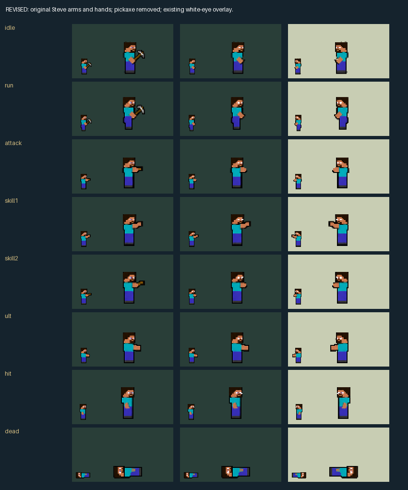

# Universal AI, balance and Creative Herobrine

Native **0.10.63**, Blockcraft **0.1.22**, champion pack **0.2.63**, Frieren **0.1.20**, JoJo **0.1.19**, Valorant **0.1.14**. Based on main `0365335`, isolated branch `codex/balance-creative-herobrine`. Frieren 0.1.19 remains reserved for the separate objective/Stark PR #39; that PR is not merged into this change.

## Result

- Frieren's basic, spells, Fern and Stark raw damage use 80% once. Coder base HP/growth are 1000/108 and created shields use 75% once after support bonuses. Dio's normal/farming knives use 75%, rounded down before mitigation. Omen Step reaches 75000; both teleports root their owner during their existing channels and keep fixed destinations.
- Steve keeps his original base stats. His basic and recipes scale with accepted maximum HP, including the Epic/Serpen HP-component cap. Ultimate toggles persistent forms after 0.4s, with an 18s accepted-switch cooldown. Steve spends three of four independently recovering slots; Herobrine may spend all four. Switching does not heal or refill anything. Boat Wall is a separate three-charge, 80s signature.
- All 45 catalogue entries are available in the lab. Steve retains Apple, Shield Guard, repair and rod rescue. Herobrine has 43 selectable entries, empty hands, the approved white-eye overlay, reduced defences and 30 Creative choices. Helpful Creative protection excludes its original caster. Same-name periodic effects select the strongest contribution, including overlapping sources from the same owner.
- Redstone has paid single-use payloads, bounded acyclic links and delayed signals. Destruction cancels downstream activation; editing/rotation preserves object identity, health, lifetime and paid ammunition. Death clears owned constructions without cleanup explosions. Granted shields finish normally.
- Macro, Micro, Map Awareness and Strategy are saved in the mod namespace by career/athlete. Initial offsets use a separate identity hash. Development is idempotent by day/set and capped at four qualifying sets/day; only server processing writes career progress. Profiles v2 pin current ratings/stats per match/set. V1 profiles decode with neutral additions and retain their old decision arithmetic.
- Both teams receive bounded team intentions, a Strategy/Judgement caller, explicit jobs, wave reservations and conservative public-terrain arrival estimates. The planner compares waves, assigned camps, objective preparation/contests/stalls/withdrawal, tower trades, visible teammate reinforcement and team resets. It reads visible HP/trends and timestamped sightings; hidden enemies add uncertainty. It writes only recognized supported strategy fields, respects later coach edits, and changes only ordinary movement inputs. Stock attacks and casts remain engine-owned.

## Approved artwork

The rejected long-arm proposal is not integrated. The approved edit retains Steve's original short arm/hand pixels and removes the pickaxe. The original armed atlas remains byte-identical for legacy definitions. New definitions use a separate unarmed base plus an extracted original weapon layer in Steve form; Herobrine uses the existing white-eye layer. Composition reconstructs every original armed frame exactly. All 31 frames, both facings, original timing and 36x44 canvas are checked. Original skill-effect PNG bytes and animation metadata are preserved; the fourth pip copies existing pip artwork. Decoded Blockcraft art is **3,547,136 bytes**, below 32 MiB; the added atlas is 512x220.

## Automated evidence

- Native release: **test result: ok. 517 passed; 0 failed; 4 ignored; 0 measured; 0 filtered out; finished in 20.40s**. Four pre-existing ignored tests remain explicitly ignored; benchmark suites run separately.
- Steve shared core: 46 tests, including every new entry, form/charge restrictions, snapshots/caps, redstone payment, overlap deduplication, capture/cleanup and rotation. Frieren shared lab: 16 tests. Gojo shared lab: 81 tests; kit mechanics remain unchanged.
- Steve: **12960 complete native/WASM frames**, 24 development + 12 holdout scenarios; every one of the 45 recipes accepts/resolves/replays. The frozen original v1 WASM matches the current v1 reader and native vector runner for 140 frames.
- Team planner: **1512 native/WASM frames** over 72 scenarios: 24 development + 12 holdout seeds on each team. Fixtures show different actual choices/assignments when changing each new attribute independently, plus daily/result deduplication and independent sessions.
- Nine backed-up migration tests; 36 canonical definitions reproduce without changes. Both-facing art, legacy effects, atlas limits and approved body composition pass.
- Catalogue: 60 stock + 17 custom champions, 231 slots and 11,550 metadata/team/role/target combinations. This is **catalogue/policy coverage, not 11,550 observed casts**. See [the coverage matrix](universal-farming-coverage.md) and [stage explanations](creative-results/farming-catalogue.json).
- Isolated Mod Manager package fixture: **717 files compared, 0 differ, 0 missing; native DLL identical**. The installed game was not used as this fixture.

## Five-run performance

Matched Steve scenes use the frozen original core and the candidate with the same positions, unit counts and 1800 ticks. Authorized rework/decision changes remain enabled. Each value below is the median of five p95/p99 measurements; these small changes are not presented as an optimization win.

| Scene | Original p95 | Candidate p95 | Candidate p99 |
|---|---:|---:|---:|
| 32 units | 0.0296 ms | 0.0301 ms | 0.1013 ms |
| 64 units | 0.0300 ms | 0.0307 ms | 0.1021 ms |
| 128 units | 0.0313 ms | 0.0315 ms | 0.1043 ms |

Magnus 128-piece release-core p95 across five runs: **0.793, 0.773, 0.837, 0.829, 1.078 ms**, all below 4 ms. New team planning with ten actors and 32 targets, including public-terrain routing: p95 **0.254–0.313 ms** per evaluation. Cold and sustained samples are separate in [performance.json](creative-results/performance.json). Native host calls and rendering are excluded. No freeze fix or real-match clear-time improvement is claimed.

## Compatibility, migration and controls

- F8 opens the in-game athlete panel; F9 selects the next athlete, with the player's roster first; F10 changes an owned athlete's development focus. The editor's **Athlete Game Sense** lab exposes ratings, assignments, reasons and practice development. Practice buttons do not award career progress.
- Run `rtk proxy python -X utf8 tools/migrate-champion-reworks.py PATH` to inspect an existing career/export. Inspection does not write. `--output NEW_PATH` creates a separate migrated file; `--in-place` requires and verifies a complete backup before atomic replacement. The update preserves career records, history and items. Coder's customized embedded HP/growth are multiplied by 80% exactly once using a version marker; other champion stats are preserved. Steve visual bindings/sprite and Frieren's attributed basic are refreshed explicitly.
- Older Steve definitions retain their original armed base asset. Frozen v1 lab/recording code remains separate from the new runtime. Transfers preserve athlete identity and development. Missing recorded profiles are reported and use a neutral fallback.
- Optional `ai_diagnostics.enabled` records eligibility, selected engine inputs and subsequent cooldown-consumption evidence separately; HP changes are labelled **unattributed**, never proof of delivery. Optional `perf.flag` adds bounded simulation/origin/owner-stage timings. Neither observer injects casts or consumes combat randomness.

## Pending live acceptance and practical limits

No installation or real-career migration was performed. Live checks remain pending: stock skill selection/accepted casts/delivered contribution across roles and targets; native carrier targeting, item/kill attribution, animations and crowded fights; actual Omen channel immobility; in-game panel and training attribution; accepted strategy enum shapes and coach transitions.

The SDK provides no general wrapper around all stock actions. Strategy/movement advice cannot guarantee a stock skill will be cast. Native cast fixtures and broad target filters are not substituted for that evidence. The catalogue marks selection, execution and delivery as pending where they have not been observed.

The host exposes no explicit training-completed event. The management bridge uses a positive server-observed change in the athlete's `training_exp` (or its rollover with a stat gain), an authenticated calendar date, and excludes callbacks carrying MatchFinished. A date message alone cannot award progress. This integration is conservative and needs live confirmation; missed/unavailable evidence grants nothing. Objective values are prototype utility weights; routes and future contribution remain estimates rather than hidden-information forecasts.

The separate objective HP/Stark leap work stays in PR #39. This release scales current-main Stark damage; it does not claim that unmerged leap restoration is present.

## Reproduction and package identity

Run `rtk proxy python -X utf8 tools/deliver-creative-checks.py` with the local lab server on port 7284. The pipeline builds native/WASM labs, runs tests and browser parity, repeats five-run benchmarks, builds the DLL in two separate target directories and checks an isolated package with Mod Manager. It does not install or migrate a career. Canonical generation is checked separately by `tools/verify-creative-generation.py`.

Toolchain: rustc 1.98.1 (48a229cea 2026-09-01). Two builds and the packaged DLL have SHA-256:

`f1044f28d5a68eb9bca5bc212c21fd60b4bfaade8e1dab152f525d6d54ac62f5`

Native source/Cargo fingerprint: `bef7dede081c85ebf39f09fc01c59ad6a0f941f85c11c4d24fe0dc094705d887`. Complete hashes and actual command outputs are in [creative-results](creative-results/package.json).
