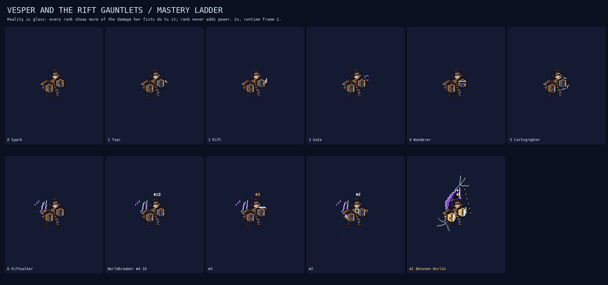
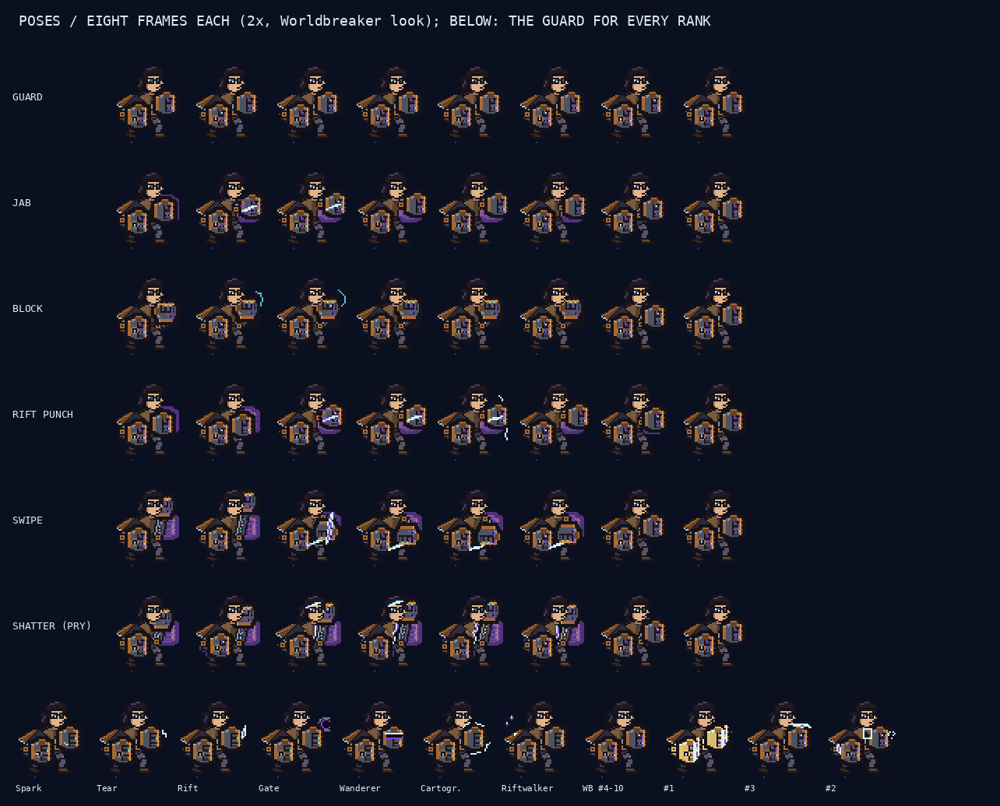

# Vesper and the Rift Gauntlets: design and player guide

Vesper is an Arcane-inspired brawler built around two oversized mechanical gauntlets. She has **no active skills and no ultimate**. A native passive (`tfm2_custom_ai:vesper`) gives her:
- a left gauntlet of **pure orbs**;
- a right gauntlet of **hexorbs** around an evolving **Hexcore**;
- the 100 dimensions, 10 rift types and 28 techniques.

Every orb is a key that can open **any** of the 100 dimensions. The dimension it opens decides what happens.

Everything is available at mastery rank 0. Rank only changes how well the athlete plans, plus how she and her tears look.

- [Every dimension (zone, punch and swipe), rift type, technique and module with its numbers](vesper-catalogue.md)
- [Verification](vesper-verification.md)
- Rift Lab: open the Database Editor and press **Rift Lab**. The Gauntlet panel has the sockets, the dimension pickers, Overload, Shatter, Vent, Awaken and Overclock, the Hexcore meter and the module preset.

## The two gauntlets

| | Left gauntlet: pure orbs | Right gauntlet: hexorbs |
|---|---|---|
| What an orb is | A key to any of the 100 dimensions | A pure orb fused with Hextech at the Hexcore's completion % |
| Count | 5 base; Overload forces up to 9 | 2 at 70% completion, 3 at 75%, 4 at 80%, 5 at 85%, 6 at 90% |
| Cooldown | 5 s per socket; an overload socket 7 s | 3 s; 2.5 s from 90% completion |
| Strength | 100% | The completion % (70% at the start of a fight) |
| Extra | Combos and family-pair twists | Fires its tech module |
| Breaks | Under stress: from overload, or enemy hits while overloaded | Only by overclocking an Awakened Hexcore |

Each socket has its own cooldown, and each spent orb recovers on its own.

A rift type costs as many orbs as it used to cost charges: Tear 1, Sky Rift 2, Maw 3, and so on. Pure orbs and hexorbs can both pay.

## Three attacks

| Attack | When | What it does |
|---|---|---|
| **Normal attack** | No orb ready, nobody in reach, or the left gauntlet is broken | The engine basic attack, a gauntlet jab with range 45000. It hits minions, creeps and champions |
| **Rift punch** | An orb is ready (beyond the reserve she keeps) and a target is in reach | Spends 1 orb and opens the chosen dimension's **punch** effect on the target, leaving a hole in the dimension. Within 66000 she punches directly. Further away she punches into her nearest tear and the fist comes out of the chain's exit, with the chain's distance loss |
| **Rift swipe** | Spends 2 orbs | Like pulling off a mask: she tears the dimension along a 60000-long line. Enemies on it take `25 + 50% AD` and the dimension's **swipe** effect, and a Slash rift is left behind |

While punching she stops her own basic attack. With a chain she also plants her feet.

### Through the chain

Open rifts link in the order she opened them: Vesper → T1 → … → Tn. A punch through a chain loses damage per link. A link of length `L` keeps

    keep(L) = clamp(90% − 30% · (L / 120000)², 10%, 90%)

and the efficiencies multiply. A direct punch loses `keep(distance)`. Far tears open later: the rip takes `6 + distance / 12000` ticks to travel from her. So long reach is still a decision between links, orbs, stress and timing.

Every hit goes through the shared damage window: at most 35% of the target's max HP per 2 s.

## 100 dimensions, 300 behaviours

There are 10 families (Control, Ruin, Motion, Haven, Passage, Time, Veil, Matter, Hunger, Chaos), each with 10 dimensions. Each dimension has **three different deliveries**:

| Delivery | Where | Example: Gale | Example: Rewind | Example: Swap Space |
|---|---|---|---|---|
| Zone | While a rift with this dimension stays open | Pushes out | Recall point | Swap pad |
| Punch | One target, at the hole | A huge knockback; a wall slam stuns | Sends the target back to where it stood 2 s ago | Vesper and the target trade places |
| Swipe | Everyone on the tear line | A wind wall that pushes everyone off the line | Enemies on the line are rewound; allies on it get their last 2 s of HP back | The enemies at the two ends of the line swap |

More examples:
- Ember punch ignites the target and the burn spreads.
- Static Realm swipe marks everyone on the line, and the next punch arcs to all of them.
- Glass Wall punch encases the target.
- Mirror Realm punch knocks the target out of a mirror on the far side of Vesper.

The generator checks that all **300 behaviours are distinct**: no two deliveries share the same effect and numbers.

**Combo.** Orbs activated within 1 s of each other build a combo of +10% per step, up to +40%, on punches and techniques. Two families in a row also trigger one of 55 family-pair **twists**.

The skill gap lives in the pick: which dimension each orb opens, for which target, in which order.

## Shatter and the left-gauntlet break

**Shatter** crushes every pure orb she holds:
- every open rift rips to twice its radius;
- every enemy inside is banished briefly and takes `orbs × (15 + 20% AD)`, +25% per overloaded orb;
- each rift's own dimension then applies to them.

**Allies are never hurt.** Allies standing in a ripped rift are pushed safely out of it.

**Stress** runs from 0 to 100. It rises from:
- every tear (+12) and long link (+8);
- a rift broken by an enemy (+10);
- each held overload orb, every 20 ticks;
- while overloaded, every 1% of max HP she loses to enemy hits.

It decays while she holds no overload orb and has at most one rift open.

A Shatter adds the crushed orbs' load: 8 per orb, 15 per overloaded orb. If stress goes past 100, **the left gauntlet breaks**:
- it is offline for 8 s, so no pure orbs and no rift punches (normal attacks and hexorbs still work);
- she takes 6% max HP, which is never lethal, and a 0.5 s stagger;
- stress resets to 40.

Enemy hits that push stress to 100 cause a **forced Shatter and break**. That also only hurts enemies.

## The Hexcore and its tech modules

The Hexcore starts every fight at **70% completion** and researches as she fights:

| Event | Completion |
|---|---|
| Each pure orb spent | +1% |
| A takedown | +3% |
| A Shatter | +4% |
| Her death | −10%, never below 70% |

| Completion | Unlocks |
|---|---|
| 70% | 2 hexorb slots |
| 75% | 3 slots |
| 80% | 4 slots; tech-module radius 30000 → 39000 |
| 85% | 5 slots |
| 90% | 6 slots; hexorbs recover in 2.5 s |
| 100% | She can **Awaken** |

**Awakening** lasts 6 s:
- hexorbs hit at 100%;
- a pure orb and a hexorb used together **fuse**: both dimensions, the module and their twist, at 130%;
- her rifts can't be broken.

Afterwards completion drops to 85%.

**Overclock** during Awakening feeds the Hexcore one more orb:
- each feed adds +20 corruption and +5% hexorb power;
- enemy hits add corruption at only a quarter of the rate.

At 100 corruption the **right gauntlet breaks**:
- it is offline for 12 s and completion resets to 70%;
- she takes 8% max HP, never lethal;
- a hex-burst hits nearby enemies only, for `30 + 30% AD`.

This is the only way the right gauntlet breaks, so it is much harder to break than the left.

**Tech modules.** Each athlete carries 6 of these 8, derived from their athlete id. Edit them on the editor's **Mastery** page (Hexcore modules → Tune), saved to `vesper_modules.txt`.

| Module | Effect |
|---|---|
| Plating | Shields the nearest ally |
| Coil | Allies nearby move faster |
| Stasis | Slows enemies nearby |
| Magnet | Pulls enemies toward the point |
| Mender | Heals allies nearby |
| Scanner | Enemies nearby take more damage |
| Spark Arc | Arcs to the two nearest enemies |
| Anchor Bolt | Roots the nearest enemy |

A module fires:
- on every hexorb punch or swipe;
- when a hexorb opens a rift;
- every second from a rift she has **Infused**.

## Rift types

Ten shapes, all available at rank 0. Each takes the dimension of the orb that opened it.

| Rift | Orbs | What the shape does |
|---|---|---|
| Tear | 1 | Basic chain node and portal |
| Slash | 1 | A line that throws back enemies crossing it. The swipe leaves one |
| Sinkhole | 1 | A ground ellipse that slows and swallows anyone who stays 1 s |
| Sky Rift | 2 | Opens overhead: rains volleys and drops allies from above |
| Mirror Pane | 1 | Glass that bounces shots and divers |
| Twin Rift | 2 | Two rifts born linked: an instant portal pair, and swaps |
| Wandering Rift | 1 | Moves along the path she draws, carrying what it catches |
| Anchor Rift | 1 | Stuck to a unit: escorts, hooks, lifelines |
| Seed Rift | 1 | Hidden for 2 s, then a trap |
| Maw | 3 | Huge and brief: swallows everyone inside, then caves in |

## 28 techniques

| Group | Techniques |
|---|---|
| Offense | Chain Fire, Crossfire, Bank Shot, Rift Rain, Slash Volley, Implode, Domino, **Overload Punch** (spends stress for +1% damage per point, up to 60) |
| Engage | Rift Step, Ally Gate, Sky Drop, Kidnap, Sinkhole Trap, Swap, Fling, Hook |
| Defense | Phase Out, Rift Curtain, Reflect Wall, Rescue, Pocket, Lifeline |
| Team | Escort, Rotation Gate, Seed Trap, Sweep, **Infuse** (a hexorb's module on a rift for its whole life), Stitch |

The gauntlet moves sit next to these: Swipe, Shatter, Overload, Vent, Awaken and Overclock.

Displacements respect:
- `cc_immune`;
- per-target cooldowns;
- the 2-per-2-s displacement window;
- walls.

Stuns respect the 60-ticks-per-3-s control window.

A Worldbreaker sequence, for example: **Seed Trap** on the healer's path → **Sky Drop** the tank onto it → a Rewind **punch** on the diver → overload ridden into a **Shatter** with three enemies in the rifts → **Rift Step** out.

## Counterplay and risk

- **Breaking rifts.** An enemy standing on a rift's core for 1 s breaks it. This cuts the chain and adds 10 stress. The game's AI doesn't hunt rifts, so breaks come from rifts left in fight paths.
- **Diving her.** Hitting her while she is overloaded cracks the left gauntlet, and a forced Shatter costs her 6% HP and 8 s without punches. Hitting her while she is Awakened feeds corruption, but slowly.
- **Shatter needs rifts.** With nobody inside her rifts, a Shatter only spends her orbs and adds stress.

## Mastery: same gauntlets, a far better brain

Each rank adds one habit. The rank tables in `vesper_data.rs` control:
- look-ahead, candidates and noise;
- combo depth and links;
- orb craft, which decides how well she picks a dimension for each target;
- stress limit, a reserve orb and ally wait.

| Rank | Name | New habit |
|---|---|---|
| 0 | Spark | Reflex chaos: random rift types, techniques and dimensions; overloads, shatters and overclocks on a whim |
| 1 | Tear | Leads targets, including opening delays |
| 2 | Rift | Safety: watches stress, never overloads past 7 with enemies near, shatters only when the gauntlet holds |
| 3 | Gate | Geometry: chain solver, swipe and bank angles, Crossfire splits, Implode and Domino timing |
| 4 | Wanderer | Survival: keeps a spare orb, sets a Lifeline, vents overload when dived |
| 5 | Cartographer | Team engage: Gates and Sky Drops with the frontliner, Awakening timed with the team's engage |
| 6 | Riftwalker | Priority: picks every orb's dimension for its target, Infuses the frontliner's rift |
| 7 | Worldbreaker | Five-step sequences: combos families for their twist, rides overload into a 3-enemy Shatter, stops overclocking in time |
| #1 | Between Worlds | Same brain as rank 7. Visual podium only |

In 12 fixture teamfights, Spark → Worldbreaker:

| Measure | Spark | Worldbreaker |
|---|---|---|
| Left-gauntlet breaks | 39 | 0 |
| Useful Shatters | 16 of 43 | 61 of 61 |
| Swipe hits per swipe | 0.4 | 2.9 |
| Wins | 0 of 12 | 12 of 12 |
| Damage | 36k | 88k (about 2.4×) |

[Full table](vesper-verification.md).

## Look and animation

**The body.** A lean, battle-worn fighter in a compact 3/4 boxing guard:
- **Stance:** wide and staggered. The front knee is bent over the toe and the back leg is long behind her with the heel up.
- **Torso:** turned about 40° and leaning in, with a fitted dark undershirt under a sleeveless brown tunic and no armour.
- **Head:** a tomboy wolf cut (choppy fringe, side bang, nape flicks) and black glasses: the near lens cracked, the far one faint cyan.
- **Cloak:** a short bronze half-cloak trailing back from her near shoulder.
- **Gauntlets:** the lead (left, orbs) is up in front of her chest with the knuckles toward the opponent. The rear (right, Hexcore) is pulled back low beside her ribs. Elbows and forearm housings show; the fists have bronze knuckle plates, a copper thumb and only a few cyan pixels.

**Animated poses**, chosen by the native passive:

| Pose | When | Motion |
|---|---|---|
| Guard | Default | Cloak and hair sway, glints, Hexcore pulse |
| Jab | Each normal attack | The lead elbow snaps straight, recoil |
| Block | When she is hit | The lead fist comes up in front of her face |
| Rift punch | While punching | Wind-up, a thrust into reality: the flat white surface at the knuckles, the compression, the cracks, the fist tearing through, the wound collapsing |
| Swipe | After a swipe | Hand raised, a one-handed rip down |
| Shatter | After a Shatter | **The pry:** she drives her fists into a fracture and wrenches it open between them |

Where a fist leaves its guard, reality keeps a violet afterimage of it for a moment.

## Mastery: reality is glass

There are no halos, emblems or auras. Rank is the damage her fists do to reality, and the costume is the same at every rank. Every mark is a torn **scar**: a white-cyan fractured edge, a violet interior and a near-black void.

| Rank | What you see |
|---|---|
| Spark | Cyan sparks escaping the gauntlet seams |
| Tear | A tiny jagged crack flickers by her fist when she flexes |
| Rift | A thin violet scar hovers by the lead gauntlet, splitting open now and then |
| Gate | A small hole punched in the air by the lead fist, with a compression ring |
| Wanderer | Slices of her gauntlets slip behind tiny ruptures |
| Cartographer | Tiny fractures join into a broken path round her punching arm |
| Riftwalker | A jagged wound hangs behind her shoulder, fragments drifting off it |
| Worldbreaker #4–10 | Violet cracks across the knuckles exposing the void, and fracture trails on every strike |
| #3 | A split rides the lead gauntlet and sometimes opens onto another world |
| #2 | Both gauntlets carry their own ruptures, with a displaced fragment of reality floating between them |
| #1 Between Worlds | Gold-chrome gauntlets with heat haze, a massive tear suspended behind her, fingertips slipping to the other side of reality, and the biggest pry |

The Top 10 also carry a tiny plain number above the head (#10…#1; #1 gold, #2 silver, #3 bronze). Everything is cosmetic: hitboxes, timing and damage never change.

**Her rifts** are scars too. Every rift type keeps its shape identity:
- Sinkhole: a cracked ground ellipse;
- Mirror Pane: a cracked pane;
- Twin Rift: two cuts bridged by a crack;
- Maw: a cut lined with glass teeth;
- Seed Rift: a hidden hairline crack.

Links are hairline fractures. Rifts crack open, zip shut shedding glass flakes, and shatter when broken. Spark scars are hairlines; higher ranks are deeper, with shattered lips at Worldbreaker and another world inside at #1.

**HUD above her head:**
- the orb sockets (overload sockets in orange);
- the hexorb slots;
- the Hexcore (filling, white-hot when Awakened, with corruption pips);
- the stress bar.

## Logs

- `mods/tfm2_custom_ai/vesper_log.txt`: a summary every game minute, with rank, stress, orbs, hexorbs, punches, swipes, Shatters, both gauntlet breaks, Awakenings, modules and technique use.
- `vesper_damage_log.txt`: damage traces.

Both appear under **Show logs** in the manager.
